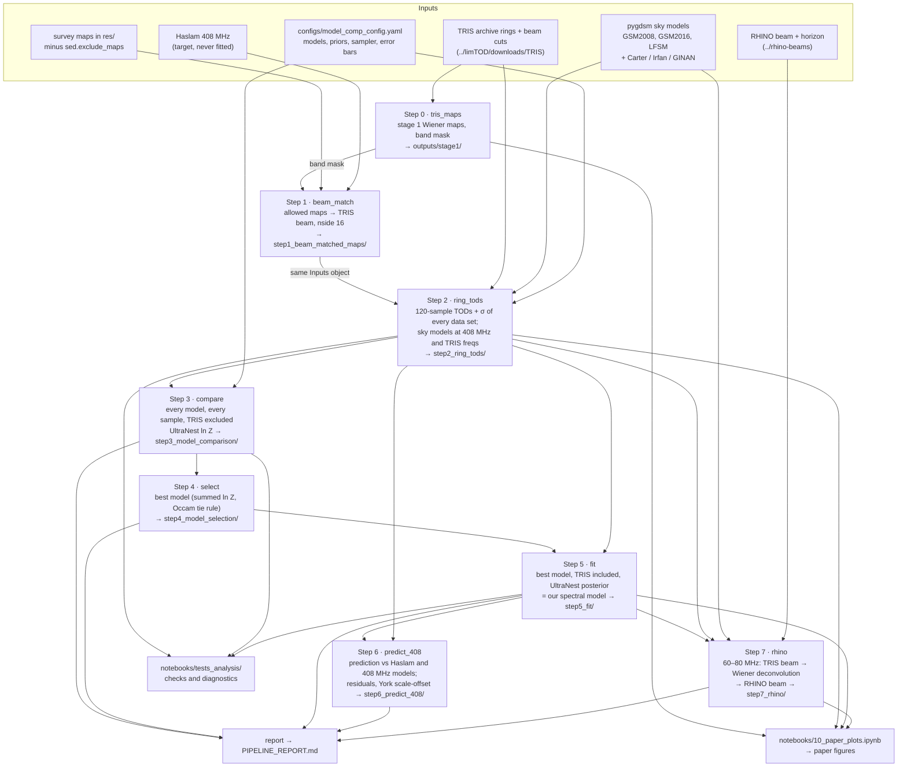

# The moonrunes pipeline

*Last updated 2026-11-17. Part I describes the end-to-end pipeline that `run_pipeline.py` runs: what each step does,
what it reads and writes, how it is configured, and which paper figures and tables come from it. Part II is the
detailed reference for stage 1 (the TRIS maps), the older stage 2 and the beam matching, and the appendices.
`README.md` is the quick start, `HANDOVER.md` maps every paper item to its source, `CHANGELOG.md` records the
changes, and `paper_outputs/pipeline/PIPELINE_REPORT.md` summarises what the last run found.*

---

# Part I — The pipeline

## P1. What it does

The aim is to test the **Haslam 408 MHz** map against an independent prediction of the 408 MHz sky along the TRIS
ring (Dec +42.4°, 120 samples), and to predict the sky at other frequencies (the RHINO band, 60–80 MHz). The
prediction is a spectral model fitted, at every ring sample, to every allowed survey **and** to TRIS, the absolutely
calibrated radiometer; Haslam is never a fit point. Every survey is first seen through the **same beam** (the
measured TRIS beam), so that a ring sample's SED compares like with like.

1. Beam-match every allowed map to the TRIS beam.
2. Make the ring TODs (120 samples) of every allowed map and of TRIS, with their error bars.
3. Fit every spectral model at every ring sample to the allowed surveys, **TRIS excluded**, and compare the models
   (UltraNest evidence by default).
4. Pick the best model.
5. Fit the best model at every ring sample to every allowed data set, **TRIS included**: this is our spectral model.
6. Predict the Haslam ring TOD at 408 MHz through the TRIS beam, and compare it with Haslam and the 408 MHz sky models.
7. Predict the RHINO drift scans (60–80 MHz): through the TRIS beam, deconvolved, observed with the RHINO beam.

Step 0 makes the TRIS maps (stage 1); their sky band is used by every later step and their maps by Figure 3.

## P2. Flowchart



## P3. Running it

```bash
conda activate limtod
python run_pipeline.py --step all            # steps 0-7, then PIPELINE_REPORT.md
python run_pipeline.py --step fit            # one step; it reads the products of the steps before it
python run_pipeline.py --from-step compare   # this step and every step after it
python run_pipeline.py --step report         # rewrite the report from the steps already run
python run_pipeline.py --step all --overwrite   # redo products that exist (including the step 5 fit cache)
```

* `--nside` and `--run-name` apply to step 0 only. `--stage 1` and `--stage 2` are the older interface
  (`--stage 1` is step 0; `--stage 2` is the older beam matching of Haslam and ARCADE 2 alone, which nothing
  reads). `--stage 3`–`5` point to `--step`.
* Each step writes `manifest.json` (settings and a summary) next to its products; `--step report` collects them.
* **Run time** (the first full run, 2026-11-16, from the times in each `manifest.json`): step 0 at 18:17; step 1
  written 19:31; step 2 about 7 minutes later (TOD-route inputs plus the pygdsm sky models; pygdsm downloads its
  data on first use); step 3 about 17 minutes of UltraNest (120 samples × 4 models, 11 points each); step 4 seconds;
  step 5 about 4 minutes (120 UltraNest fits, 13 points each); step 6 seconds; step 7 about 15 seconds with its
  sky-model cache reused. Steps 0 and 1 may not have run back to back, so their times are not durations.
* **Caches:** step 5 reuses a fit file when its prior key, TOD key and data points match (`--overwrite` redoes them);
  step 7 reuses `cache/rhino_sky_models.npz` when its key (frequencies, models, beams, TOD method, ring RA, nside, the Irfan settings)
  matches. Steps 1–3 and 6 always recompute.

## P4. Configuration

Two files, both in `configs/`, with **no setting in both**:

* **`configs/run_pipeline.yaml`**, the run config (`load_config()`, `run_pipeline.py --config`): the data (`res/`
  minus `sed.exclude_maps`, the Haslam target `pipeline.target_file`), the beam and ring (`tris:`, `beam:`,
  `beam_matching:`, `sed.tod_beam`), the corrections and every step's settings (`pipeline:`).
* **`configs/model_comp_config.yaml`**, the model-comparison config (`load_model_comp_config()`, named by
  `pipeline.model_comparison_config`): the models, priors, sampler, error bars (`configs/error_bars.csv`), the
  minimum points per sample, and what the comparison is decided on (`comparison.statistic`,
  `comparison.exclude_tris`). `scripts/model_comparison/run_comparison.py` reads the same two files.

| Setting | Value | Used by |
|---|---|---|
| `sed.exclude_maps` | ARCADE 2 ×2, Juno ×2 (the LWA1 38–74 MHz maps are in) | steps 1–2: which maps in `res/` are allowed |
| `pipeline.target_file` | `HASLAM_DESTRIPED_ONLY.fits` | steps 1–2, 6 |
| `pipeline.beam_match_kernel` | `tris_cuts` (measured E/H cuts, 19.155° × 23.366°) | step 1 |
| `sed.tod_beam` | `beam_matched` | step 2 (TODs: the `tris_cuts` kernel at the ring pointings) |
| `comparison.statistic` (model config) | `evidence` (UltraNest) | step 3 (`max_likelihood` = no Occam penalty) |
| `comparison.exclude_tris` (model config) | `true` | step 3 |
| `pipeline.select.tie_lnz` | 1.0 | step 4 |
| `pipeline.fit.seed`, `compare.seed` | 12345, 20260903 | steps 5, 3 (seed + ring sample index) |
| `pipeline.predict_408.cygnus_*` | 299.9°, ±25° | step 6 (the scale-offset fit is also made without Cygnus A) |
| `pipeline.sky_models` | native beams, Carter, Irfan (8.9 K; `irfan_nu0_mhz` 45, `irfan_beta_map`, `irfan_cs_map`: Irfan & Puglisi's β_s and c_s maps), GINAN, LFSM extension | steps 2, 7 |
| `pipeline.rhino` | 60–80 MHz, beam and horizon files, latitude, prior GSM2016, model list | step 7 |
| rest of `configs/model_comp_config.yaml` | power law, curved power law, moment expansion (orders 2, 3; β fixed at −2.7); priors; 400 live points, dlogz 0.5; `error_bars.csv`; `min_points: 4` | steps 2, 3, 5 |

## P5. The steps

Code: `src/moonrunes/pipeline.py` (`step_<name>`). Products: `paper_outputs/pipeline/<step folder>/`.

### Step 0 — `tris_maps` (stage 1)
* **Does:** a prior-regularised (Wiener) map of each TRIS ring at 600 and 820 MHz on nside 16, with a fitted zero
  level; details in §4 below.
* **Reads:** the TRIS archive (`paths.tris_archive_dir`), GSM2008 (prior), `tris:` and `beam:` in the config.
* **Writes:** `outputs/stage1/tris_maps_<run name>.npz`, `stage1_manifest.json`.
* **Read by:** every step that builds `sed_prototype.Inputs` (the band mask); Figure 3 (the maps); the diagnostics.

### Step 1 — `beam_match`
* **Does:** every allowed map (the usable fit maps in `res/` not in `sed.exclude_maps`, plus the Haslam target) is
  rotated to equatorial, smoothed to the TRIS beam with the map's own beam taken out (kernel
  `pipeline.beam_match_kernel`), masked where less than half the beam weight was observed, and regridded to nside 16
  (`sed_prototype.Inputs._to_grid` → `stage2_beam_matching.match_to_tris_beam`). The method is Appendix A.
* **Writes:** `step1_beam_matched_maps/beam_matched_maps.npz` (maps, names, files, frequencies, native beams, band
  mask), `beam_matched_maps_summary.csv` (pixels kept per map), `manifest.json` (the smoothing record per map).
* **Read by:** nothing downstream; the maps are a product in their own right (the ring TODs of step 2 use the same
  kernel evaluated at the ring pointings, which keeps the full resolution of the kernel instead of sampling nside 16
  pixels).

### Step 2 — `ring_tods`
* **Does:** for every allowed map and the Haslam target, the TOD along the TRIS ring: the `tris_cuts` kernel with
  the map's own beam taken out, evaluated at the 120 ring pointings (RA = LST 0–357° in 3° steps, Dec +42.433°),
  kept where the observed beam weight is ≥ 0.5; converted to Rayleigh–Jeans with the CMB removed. The TRIS data are
  the archive rings minus T_CMB,RJ, with σ = statistical ⊕ zero level. Survey σ from `error_bars.csv`; Haslam's σ is
  10% ⊕ 3 K. The same beam is applied to the comparison sky models: GSM2008, GSM2016, LFSM and Haslam with the
  Carter and Irfan corrections at 408 MHz, GINAN on GSM2016 (built at 350 MHz and carried to 408 MHz with GSM2016's
  spectrum), and the models carried to the TRIS frequencies (Carter with the base model's per-pixel spectrum; Irfan with
  Irfan & Puglisi's own β_s and c_s maps, ν₀ = 45 MHz, their eqs. 1, 2, 6 and 11, `pipeline.irfan_scaling`; LFSM with
  its own 300–408 MHz index). Step 7 carries GSM2008 + Irfan to 60–80 MHz the same way.
* **Writes:** `ring_tods.npz` / `.csv` (the SED table: keys, ν, T, σ per sample, Haslam T and σ, TOD key);
  `beam_matched_tods.npz` / `.csv` / `_meta.csv` (`survey::<file>`, `model408::<name>`, `modeltris::<name>::<TRIS
  band>`); `sky_tods.npz` (the 408 MHz models with their coverage, in the order Haslam, Carter, Irfan, GSM2008,
  GSM2016, GINAN, LFSM).
* **Read by:** steps 3, 5, 6, 7; `10_paper_plots` (Figures 4, 8, 9: `beam_matched_tods.npz`); `notebooks/tests_analysis/` Parts
  A, B, E–I.

### Step 3 — `compare`
* **Does:** at every ring sample, the usable points (finite, T > 0, σ > 0) of the allowed **surveys only** (TRIS
  excluded) — currently LWA1 35, Maipu 45, LWA1 80 and Stockert 1420; CHIPASS and Rhodes/HartRAO never reach the
  ring — are fitted with every model of `configs/model_comp_config.yaml`. With `statistic: evidence`, UltraNest's ln Z
  per model (Gaussian likelihood with the published σ, priors as configured); with `max_likelihood`, the best fit in
  the prior box (24 starts). Samples with fewer than `min_points` (4) points are skipped.
* **Writes:** `evidence_per_unit_tod.csv` (ln Z ± error per sample and model) and `evidence_summary_tod.csv` (summed
  ln Z, wins), or the `maxlike_*` equivalents — the same format as `scripts/model_comparison/run_comparison.py`.
* **Read by:** step 4; `notebooks/tests_analysis/` Parts C and D (Section 5's counts).

### Step 4 — `select`
* **Does:** sums ln Z over the ring samples per model; the highest wins, except that a model within `tie_lnz` of it
  with fewer parameters is preferred. (With `max_likelihood`, the summed BIC = χ² + k ln n is used.)
* **Writes:** `selection.json` (model, parameters, scores, Δ to the best, samples won).
* **Read by:** steps 5–7.

### Step 5 — `fit` (our spectral model)
* **Does:** the selected model fitted at every ring sample to every allowed data set **with TRIS** (currently six
  points: TRIS 600.5 and 817.8, LWA1 35, Maipu 45, LWA1 80, Stockert 1420) with UltraNest, keeping the posterior:
  the same likelihood, priors and sampler as step 3, seed `fit.seed` + sample.
* **Writes:** `fits/unit###__<model>.npz` (`maxpoint`, `samples`, `logz`, `names`, the points `keys`/`nu`/`t`/`s`,
  `prior_key`, `tod_key`), `ring_ra.npy`, `fit_summary.csv` (per sample: best-fit and posterior median ± std of
  every parameter, χ² at the best fit, ln Z).
* **Our spectral model:** at frequency ν and ring sample i, T_i(ν) = model(ν; θ_i,max) (UltraNest's maximum-likelihood
  point), with σ_i(ν) = the standard deviation of model(ν; θ) over the posterior samples
  (`moonrunes.pipeline.predict`). For the power law at 408 MHz this is exactly A and its posterior σ.
* **Read by:** steps 6–7; `10_paper_plots` (Figures 8 and 9); `notebooks/tests_analysis/` Parts B, D–I, K2.

### Step 6 — `predict_408`
* **Does:** our model at 408 MHz along the ring (it already includes the TRIS beam, since every fitted point was a
  TRIS-beam TOD) against the Haslam TOD and the 408 MHz sky models of step 2: model − prediction (median, rms, χ²/N
  with σ = the prediction's σ), and the York fit model = a·P + b with errors on both axes (every model given Haslam's
  σ, as `notebooks/tests_analysis/` Part F), over all samples and without Cygnus A ± 25°.
* **Writes:** `prediction_408.csv` (per sample: P, σ_P, Haslam, Haslam − P, every 408 MHz model),
  `residuals_408.csv` (`tab:408-residuals`), `scale_offset_408.csv` (`tab:scale-offset`).
* **Read by:** the paper tables (by hand); the report.

### Step 7 — `rhino`
* **Does:** our model at 60, 65, 70, 75, 80 MHz along the ring (through the TRIS beam), deconvolved from the TRIS
  beam with a Wiener filter (operator A = the TRIS cut beam at the ring pointings on nside 16; prior = a sky model,
  `deconvolution_prior`, with stage 1's prior width 10% ⊕ 0.3 K), then observed with the RHINO `DryHornGround` beam
  at the Jodrell Bank zenith above its horizon, LST = ring RA. The sky models go through both beams the same way;
  GSM2008 + Irfan is carried from 408 MHz with Irfan & Puglisi's β_s and c_s (`irfan_scaling`), GSM2008 + Carter with
  GSM2008's own spectrum, GINAN is built at each frequency.
  Uncertainty through the RHINO beam: √diag(R Σ Rᵀ) with Σ the Wiener posterior covariance.
* **Writes:** `rhino_tods_tris_beam.csv`, `rhino_tods_rhino_beam.csv` (per LST: this work ± σ and every model, K),
  `rhino_summary.csv` (medians, model − this work), `rhino_checks.csv` (closure, RHINO beam on TRIS-covered sky, power
  below the horizon), `cache/rhino_sky_models.npz`.
* **Read by:** `10_paper_plots` (Figure 10 and `rhino_tods_tris_beam`).

### Report
`python run_pipeline.py --step report` (also run at the end of every pipeline run) writes
`paper_outputs/pipeline/PIPELINE_REPORT.md` from each step's `manifest.json`, with plain-text tables read from the
products (`pipeline.REPORT_TABLES`):

* **Step 3:** every model's Σ ln Z ± error, Δ ln Z against the best, parameters, and the samples where it has the
  highest ln Z (`evidence_summary_tod.csv`).
* **Step 4:** the selection criteria (statistic, highest score, models within `select.tie_lnz`, tie-break, chosen
  model) and each model's score against them (`selection.json`).
* **Step 6:** the top 3 sky models against our 408 MHz prediction, ranked by χ² with the prediction's σ, with χ²/N,
  median, mean and rms of model − prediction and the samples within 1σ (`residuals_408.csv`).
* **Step 7:** per beam (TRIS, RHINO), the top 3 sky models against our prediction, ranked by χ²/N with our σ over
  every sample and frequency, with the median model − prediction at each frequency and the overall rms
  (`rhino_tods_*.csv`).

`run_pipeline.py` prints the total run time when it finishes.

## P6. Data sets

| | TRIS 600 / 820 | LWA1 35, LWA1 38–74 (7 maps), Maipu 45, LWA1 80, Stockert 1420 | CHIPASS, Rhodes | ARCADE 2, Juno, WMAP | Haslam |
|---|---|---|---|---|---|
| step 1 maps | — (TRIS is the beam) | yes | yes (no ring coverage) | excluded / unusable | yes (target) |
| step 2 TODs | ring data | yes, 120 of 120 samples | 0 of 120 samples | — | yes (target) |
| step 3 comparison | **excluded** (`comparison.exclude_tris`) | yes | — | — | never |
| step 5 fit | yes | yes | — | — | never |

So the comparison uses 11 points per sample and the fit 13. The paper's Sections 5–7 were written from an earlier
4-point comparison and 6-point fit, without the LWA1 38–74 MHz maps (see P10).

## P7. Products and who reads them

| Product | Step | Read by |
|---|---|---|
| `outputs/stage1/tris_maps_tris_haslam_v0.npz` | 0 | every `Inputs`; `10_paper_plots` cell 7 (Figure 3); diagnostics |
| `step2_ring_tods/beam_matched_tods.npz` | 2 | `10_paper_plots` cells 1, 3, 10, 22, 28; `tests_analysis` A, E, H, I |
| `step2_ring_tods/sky_tods.npz` | 2 | step 6; `tests_analysis` B, E–H |
| `step2_ring_tods/ring_tods.npz` | 2 | steps 3, 5, 6, 7 |
| `step3_model_comparison/evidence_*.csv` | 3 | step 4; `tests_analysis` C, D |
| `step4_model_selection/selection.json` | 4 | steps 5–7 |
| `step5_fit/fits/`, `ring_ra.npy` | 5 | steps 6–7; `10_paper_plots` cells 22, 28; `tests_analysis` B, D–I, K2 |
| `step6_predict_408/*.csv` | 6 | paper tables `tab:408-residuals`, `tab:scale-offset` (by hand) |
| `step7_rhino/rhino_tods_*.csv` | 7 | `10_paper_plots` cells 25–26 |

## P8. Conventions

Temperatures are Rayleigh–Jeans with the CMB removed (`sky_maps.rj_excess`, `cmb_rj_k`). The ring: 120 samples,
RA = LST 0–357° in 3° steps, Dec +42.433° (limTOD's `tris_zenith_geometry`). The beam: the measured TRIS cut beam,
19.155° (E) × 23.366° (H), E plane 7° east of the meridian, zero beyond 90°; a survey's own beam is taken out in
quadrature (`scaled_cuts` above ~1.2°); a sample is kept when ≥ 0.5 of the beam weight is observed. Survey errors:
the published scale, zero-level and noise terms in quadrature (`error_bars.csv`, the same numbers as
`sed_prototype.PUBLISHED_ERRORS`). Models: x = ln(ν / 408 MHz). Pivot 408 MHz, so the power law's A is the 408 MHz
temperature.

## P9. The notebooks and the pipeline

The `notebooks/tests_analysis/` Parts read the pipeline's products rather than building them: Part A the TODs (step 2),
Part B the power-law fits and 408 MHz sky-model TODs (steps 5 and 2), Part J's Test 6 the RHINO prediction (step 7).
The older build cells are archived in `../moonrunes_archive_2026-11-16/notebooks/test_results.ipynb.before_pipeline`. Parts B (curved power law), F (scale-offset figures) and J (Tests 1–5 on
13 points) remain as checks with outputs in `test_outputs/`. `scripts/model_comparison/run_comparison.py` is a
standalone tool (the same two configs and data sets; it also runs the map route); the pipeline uses its helper
functions. `notebooks/10_paper_plots.ipynb` reads `paper_outputs/pipeline/` and `outputs/stage1/`.

## P10. The 2026-11-16 run against the paper

Full run of 2026-11-16 (18:17–19:59), LWA1 38–74 MHz maps included (11 points per sample in step 3, 13 in step 5).
**Paper numbers made from the 4- and 6-point sets are stale** wherever they come from the pipeline:

* **Section 5 (step 3):** summed ln Z, power law −10424.45; curved power law −36.27 behind it, moment expansion
  orders 2 and 3 −140.72 and −149.44. The power law has the highest ln Z at 98 samples, the curved power law at 22
  (the 4-point run: 120 and 0). Step 4 selects the power law. The "0/114/6" and "68 borderline" counts
  (main.tex:501) need `notebooks/tests_analysis/` Part C rerun.
* **Our model (step 5):** A median 32.15 K, posterior σ median 0.168 K; β median −2.487; χ²/dof median 0.59 (the
  6-point fits: 32.13 K, 0.170 K, −2.483, 1.00).
* **408 MHz (step 6):** GSM2016 is closest (median −0.84 K, χ²/N 133.6; 6-point fits: −0.81, 130.7).
* **RHINO (step 7):** fed by our model, as designed; Figure 10 and the Section 7 numbers to be redrawn from
  `step7_rhino/`.
* **Step 1** has no notebook predecessor (the map route used `beam_matching.kernel`, the circular kernel).

Full results in `PIPELINE_REPORT.md`; the numbers above are from the step manifests.

## P11. Status

One end-to-end run (2026-11-16). Its manifests record the config paths of the time (`configs/run_config.yaml`,
`scripts/model_comparison/config.yaml`). Since then (2026-11-17) the Irfan correction is carried off 408 MHz with Irfan &
Puglisi's β_s and c_s maps, so **steps 2 and 7's Irfan products are out of date until those steps are rerun**; every
other value the run used is unchanged. The report tables (steps 3, 4, 6, 7) appear at the next `--step report`.
`tests_analysis` and `10_paper_plots` not yet rerun on its products.

---

# Part II — Reference

The sections below are the earlier description of the stages, kept for their detail; their numbering is unchanged
so that references elsewhere ("§4", "Appendix A.9") still hold. "Stage 1" is step 0 above. "Stage 2" (§5) is the
older beam matching of Haslam and ARCADE 2 alone (`run_pipeline.py --stage 2`), which nothing downstream reads; step 1
applies the same method to every allowed map. "Stage 3" (§6) is `sed_prototype`, whose `Inputs` the pipeline uses.

## 2. Inputs

All local. Nothing in the pipeline touches the network. `DATA_SOURCES.md` has the archive
page for every file.

### Used by the pipeline

| input | file(s) | format as found | frame | units | unobserved sky | used by |
|---|---|---|---|---|---|---|
| TRIS 600 / 820 MHz rings | `TRIS_absolute_600.txt`, `_820.txt` (`paths.tris_archive_dir`; copies in `res/`) | text: RA, T, statistical σ; 120 samples, every 3° in RA | equatorial (RA) | K, Rayleigh-Jeans, **CMB included** | — | stage 1 |
| TRIS beam | `TRIS_Beam_Profile.txt` | E- and H-plane cuts, dB vs angle to 176° | — | — | — | stage 1, stage 2 (target) |
| Haslam 408 MHz | `res/HASLAM.fits` (`paths.haslam_map_fits`) | HEALPix RING, nside 512 | Galactic (`COORDSYS`) | K, RJ, CMB included | none (full sky) | stage 2 |
| ARCADE 2 3.15 / 3.41 GHz | `res/ARCADE2_315.fits`, `_341.fits` | HEALPix **NESTED**, nside 16, with an `N_OBS` column | Galactic (stated as `SKYCOORD`, which healpy does not read) | **K thermodynamic**, CMB included, dipole removed | **exact 0.0** (~93% of the sky) | stage 2 |

Details that matter downstream:

* **TRIS 2.5 GHz** is a 6-point set, not a ring. Stage 1 refuses it.
* **Each TRIS ring has one row with σ = 0.000 K**, so a noise floor is mandatory
  (`tris.uncertainty_floor_k`; see §8 for its current value).
* **The TRIS zero level** is published as 0.066 K at 600 MHz, and as **+0.430 / −0.300 K**
  (asymmetric) at 820 MHz.
* **Beam widths.** TRIS is 19.155° (E) × 23.366° (H), measured from the cuts; the ring
  header's "18°" is 6% off. Haslam is 56′ (`BEAMSIZE`). ARCADE 2 is 11.6° (`BEAMSZ`,
  LAMBDA, Singal et al. 2011).

### Reference maps in `res/`, not used by any stage

`MAIPU_45mhZ.fits`, `LWA_35MHz.fits`, `LWA_80MHz.fits`, `HASLAM_DESTRIPED_ONLY.fits`,
`CHIPASS_1400MHz.fits`, `STOCKERT_VILLA_1400MHZ.fits`, `RHODES_HARTRAO_2326MHz.fits`,
`WMAP_K.fits`, `WMAP_Ka.fits`. These are read, plotted and simulated through the TRIS beam
in `notebooks/diagnostics.ipynb` Part A (was `01`, sections 05–06), which handles their varied formats:

* CHIPASS is an HPX-projection image, converted 1:1 back to nside 1024;
* Rhodes/HartRAO is a table with no layout keywords: nside and pixel ordering are inferred
  from the data;
* LWA1 is equatorial but states no frame;
* Stockert is in mK; Rhodes has the CMB removed; CHIPASS includes it.

---

## 3. Conventions

| | convention | why |
|---|---|---|
| **Common frame** | **Equatorial** (healpy `C`, J2000) | the frame of the TRIS maps. Everything else is rotated into it; TRIS is never rotated |
| **Common grid** | **nside 16**, RING (3.66° pixels; `tris.nside` = `beam.nside_new`) | the grid stage 1 makes the TRIS maps on, so every other product is put on the TRIS grid |
| **Common beam** | **23.366° circular Gaussian**, the larger TRIS axis (`beam_matching.kernel: circular_gaussian`). The measured, elliptical TRIS beam (`tris_cuts`, Appendix A.9) is implemented but not in use | every other map is smoothed to the TRIS beam, never the reverse. Before 2026-10-13 a circular 23.366° Gaussian was used, because `hp.smoothing` cannot apply an elliptical kernel; it is still available as `circular_gaussian` (Appendix A.9) |
| **Unobserved pixels in products** | `hp.UNSEEN` in stage 2; NaN plus an explicit `band_mask` in stage 1 | — |
| **Temperatures** | each product keeps its survey's own convention, recorded in its manifest | the CMB and RJ/thermodynamic conversions belong to the SED step (stage 3) |
| **Pixel ordering on read** | `hp.read_map` reorders NESTED → RING; every consumer reads through it | — |

The frames were confirmed against the sky, not only from headers (`notebooks/diagnostics.ipynb` Part B, was `04`). After
rotation, Sgr A*, Cas A and Tau A sit within 0.08–0.15° of their literature positions, and
the unrotated control misses them by ~4.7°. The TRIS rings peak at RA 305.8°, 5° from the
predicted Cygnus plane crossing.

The coordinate epoch of the TRIS archive is not stated (RA = LST, epoch of date).
Precession of ~0.014°/yr is negligible against 3° samples.

---

## 4. Stage 1 — TRIS maps

`python run_pipeline.py --stage 1` → `stage1_tris_maps.run_stage1()`

### 4.1 Model

Each ring is a linear-Gaussian problem:

$$d = A\,x + n, \qquad A = [\,B \mid \mathbf{1}\,], \qquad n \sim \mathcal{N}(0, N),\; N = \mathrm{diag}(\sigma_i^2)$$

* **$d$:** the 120 archive temperatures, used exactly as published.
* **$x$:** the sky temperature in each selected pixel, plus one zero-level offset $z$.
* **$B_{tp}$:** the fraction of the beam on pixel $p$ at sample $t$. limTOD builds it as
  follows:
  * **geometry** (`tris_zenith_geometry`): boresight at RA = LST (the sample's RA),
    Dec = 42.43°, with the E plane rolled 7° east;
  * **beam:** drawn from the archive cuts (`tris_cut_beam_map`) **at the map's nside**,
    up-sampled to `tris.nside_hires`, rotated to each pointing, cut below the horizon
    (`beam.apply_horizon_mask`), and normalised to unit sum.
* **$\sigma_i$:** the published statistical error, floored at `tris.uncertainty_floor_k`
  (`null` means the ring's smallest positive σ, about 4 mK).

### 4.2 Pixel selection

The beam is first projected onto the whole sky. A pixel is kept if its beam response
exceeds `tris.beam_response_threshold` (0.01) of the peak **in at least one sample**. At
nside 16 that gives **1272 pixels** (41.4% of the sky, 99.6% of the beam power), shared by
both frequencies. Convergence over the threshold (0.003 / 0.01 / 0.03) moves the maps by
at most 0.40 σ. The fitted zero level moves by ~0.1 K.

### 4.3 Prior

There are 1273 unknowns against 120 samples, so a prior is required. **GSM2008** (`pygdsm`)
at the ring's effective frequency (600.5 / 817.8 MHz) is degraded to `tris.nside`, rotated
Galactic → equatorial, and has the RJ CMB monopole added. Its per-pixel width is
$\sigma_\mathrm{prior} = \sqrt{(0.10\,\mu)^2 + 0.3^2}$ K, floored at 1 mK
(`tris.prior.*`). The zero level has prior $0 \pm 0.5$ K (`tris.zero_level_sigma_k`).

GSM2008 is also stored as the reference "truth" (`truth_k`). That is circular, and the
manifest records it (`prior_equals_truth: true`): agreement with `truth_k` is not
evidence of anything.

### 4.4 Solve and verification

The posterior is exactly Gaussian, so one dense direct solve gives it
(`limTOD.wiener_filter_map`):

$$\Sigma = (A^\mathsf{T}N^{-1}A + P^{-1})^{-1}, \qquad \hat{x} = \Sigma(A^\mathsf{T}N^{-1}d + P^{-1}\mu)$$

with $\sigma_\mathrm{post} = \sqrt{\mathrm{diag}\,\Sigma}$. Nothing is sampled.

**Convergence cross-check: off** (`tris.solver.cross_check: false`, since 2026-10-14).
When on, each solve is compared with an exact reference solve (the matrix inversion
lemma, which needs only a 120×120 inverse), and stage 1 refuses to write a product that
differs by more than `tris.solver.cross_check_max_sigma` (1e-4 posterior σ). That
robustness is not needed yet, so the reference is not computed and the manifest records
`null`. The last products made with it on agreed to ~1e-10 σ.

The residual is $r = d - A\hat{x}$ (zero level included), and $\chi^2 = r^\mathsf{T}N^{-1}r$.
`notebooks/diagnostics.ipynb` Part C (was `03`) derives the residual's expected scatter,
$\mathrm{Cov}(r) = N - A\Sigma A^\mathsf{T}$.

### 4.5 Output

`outputs/stage1/tris_maps_<run>.npz` + `stage1_manifest.json`; `load_stage1()` reads them.

| array | contents |
|---|---|
| `sky_k`, `sky_sigma_k` | posterior mean and σ per selected pixel, per frequency |
| `sky_full_k`, `sky_sigma_full_k` | the same on the full nside 16 sky, NaN outside the selection |
| `pixel_indices`, `band_mask` | the selected pixels (RING) |
| `prior_mean_k`, `prior_sigma_k`, `truth_k` | the GSM2008 prior (and the circular "truth") |
| `zero_level_k`, `zero_level_sigma_k` | the fitted offset and its σ |
| `data_k`, `residual_k`, `ra_deg`, `beam_coverage` | the ring, its residual, and per-sample coverage |
| `freq_mhz`, `effective_freq_mhz`, `nside` | bookkeeping |

The manifest records the full `tris`, `beam` and `run` config blocks, the per-frequency
diagnostics, the beam-grid comparison and the environment.

### 4.6 Current numbers

Product written 2026-10-02: nside 16, `nside_hires` 16, automatic noise floor.

| | 600 MHz | 820 MHz |
|---|---|---|
| reduced χ² | 16.1 | 5.9 |
| fitted zero level | +1.737 ± 0.043 K | +0.516 ± 0.027 K |
| pixels the data narrowed by >5% | 23 / 1272 | 7 / 1272 |

### 4.7 What these maps are, and are not

* **Prior-dominated.** 120 samples through a 19–23° beam carry roughly 15 independent
  numbers, so most pixels stay close to GSM2008.
* **The zero level is GSM2008's deficit, not an instrument offset.** It matches the
  template's measured deficit (1.92 K and 0.56 K cold, `notebooks/diagnostics.ipynb` Part A), and the sky
  monopole and $z$ are degenerate (≈ 1). Whether to add $\hat{z}$ back into the sky
  temperatures is open (TODO N-3).
* **`nside_hires` = 16 has a measured cost.** With 64, the same run gives χ² 3.09 / 3.22
  and 388 / 201 narrowed pixels. Separately, the beam is always drawn at the map nside,
  never finer (S1-7).
* **The maps are pixel-scale reconstructions.** Neighbouring pixels trade off by several
  σ, and a few pixels have unphysical (negative CMB-subtracted) values. This matters for
  the SED step (N-2).
* **A residual bump at RA ≈ 260–340°** (the Cygnus crossing) is unexplained. Candidates are
  the beam's pixelisation, the prior width, or pixelisation of the sky (N-6).

---

## 5. Stage 2 — matching to TRIS

`python run_pipeline.py --stage 2` → `stage2_beam_matching.run_stage2()`

*Why beams must match, what the kernel is, how the smoothing is computed and why the 0.5
floor: Appendix A. The elliptical kernel (implemented, not in use): Appendix A.9.*

### 5.1 Steps, per map (Haslam, ARCADE 2 3.15, ARCADE 2 3.41)

1. **Read and check the frame.** `frames.declared_frame()` reads `COORDSYS` or `SKYCOORD`
   from every HDU. Anything other than Galactic or equatorial stops the run.
2. **Rotate into equatorial.**
   * Haslam is full sky and band-limited at nside 512, so it is rotated in **harmonic
     space** (`rotate_map_alms`). Its G→C→G round trip is 0.08 K rms, against 0.53 K for
     pixel rotation.
   * ARCADE 2 is 93% masked, so it is rotated in **pixel space, mask-aware**
     (`frames.rotate_masked`). Data and mask are interpolated separately and divided, so
     the zero fill cannot leak into edge pixels (a plain rotation contaminates ~157 per
     band).
Steps 3–5 are one function, `match_to_tris_beam()`, which the map route
(`moonrunes.sed_prototype`) and notebook 07 (removed 2026-11-16; in git at `a5c827c`) also called. It applies whichever kernel
`beam_matching.kernel` names.

3. **Smooth to the TRIS beam.**
   * **`tris_cuts` and `elliptical_gaussian`** (implemented, not in use): `elliptical_beam.smooth_elliptical`,
     a direct sum on the sphere with the beam oriented as TRIS saw the sky (Appendix A.9).
     The kernel is chosen per map by `elliptical_beam.kernel_for`:
     * Haslam (0.93°) gets the measured beam itself; it widens the E core by 0.12%.
     * ARCADE 2 (11.6°) gets the measured beam compressed to
       √(19.155² − 11.6²) = 15.24° × √(23.366² − 11.6²) = 20.28°.
     * Partial maps are smoothed **mask-aware**, by the same normalised convolution as below.
   * **`circular_gaussian`** (in use): `smooth_to_target`, kernel
     $\sqrt{23.366^2 - \mathrm{native}^2}$: 23.35° for Haslam and 20.28° for ARCADE 2.
     ARCADE 2 is smoothed **mask-aware**: the zero-filled map and the binary mask are both
     smoothed, the first is divided by the second, and a pixel with smoothed weight below
     `beam_matching.weight_floor` (0.5) becomes unobserved.
4. **Final mask.** Keep a pixel only if it was **observed before smoothing and** passed the
   floor. This removes pixels that clear the floor without ever having been observed.
   With the elliptical kernels both are tested on the output grid: every sub-pixel of an
   output pixel must have been observed, and the weight must reach the floor at every
   evaluation point inside it.
5. **Regrid onto `beam.nside_new` (16)** with `regrid_to_nside`, rule
   `beam_matching.coarse_pixel_rule = all_children`: a coarse pixel gets the mean of its
   sub-pixels only if **all** were observed, and a finer target grid raises. Haslam is
   averaged 512 → 16. ARCADE 2 is native nside 16, so it passes through. The elliptical
   kernels evaluate straight onto nside 16 (4 points per pixel, averaged), so for them this
   step only applies the rule to the observed mask.

**TRIS is not touched.** `beam.nside_new` must equal `tris.nside`, or stage 2 raises.

### 5.2 Output

`outputs/stage2/beam_matched_<run>.npz`: `names`, `maps` and `observed` (one row per map,
nside 16 RING, equatorial, `hp.UNSEEN` where unobserved), `nside`, `frame`,
`target_fwhm_deg`, `kernel` (the `beam_matching.kernel` used; absent in products made
before 2026-10-13, which are all `circular_gaussian`).

`stage2_manifest.json` holds, per map: input path, declared frame and keyword, rotation
method, native nside, native FWHM and its source, kernel, units, and the pixel counts at
every step. Under `smoothing` it records exactly what `match_to_tris_beam` did: the kernel,
and for the elliptical ones the kernel's own E/H widths, the cut compression factors, the
expected effective beam, the orientation, working grid and a one-line note of why that
kernel was chosen.

`load_stage2()` returns an object with `.map(name)` and `.observed(name)`. The same
overwrite guard as stage 1 applies (`run.overwrite` or `--overwrite`).

### 5.3 Current numbers

**These are from the circular kernel.** Stage 2 has not been re-run since the elliptical
kernel became the default (2026-10-13); run `python run_pipeline.py --stage 2 --overwrite`
and update this table.

| map | native → kernel | observed → after smoothing | extrapolated removed | on the nside 16 grid |
|---|---|---|---|---|
| Haslam 408 MHz | 0.933° → 23.35° | 3,145,728 → 3,145,728 | 0 | 3072 (full sky) |
| ARCADE 2 3.15 GHz | 11.6° → 20.28° | 220 → 170 | 4 | 170 |
| ARCADE 2 3.41 GHz | 11.6° → 20.28° | 234 → 192 | 5 | 192 |

Checks: Haslam's mean is preserved (34.405 K) and its peak sits on the Galactic centre.
ARCADE 2 correlates with Haslam at 0.98 on the common grid.

### 5.4 Known limitations

* The elliptical TRIS beam is represented by its larger axis (`circular_gaussian`, in
  use). `beam_matching.kernel: tris_cuts` would apply the measured, elliptical beam
  (Appendix A.9); it is implemented and tested but not in use.
  What remains approximate is the treatment of surveys whose own beam is too broad to
  neglect (LWA1, Maipu, ARCADE 2): there is no exact "subtract the native beam" for a
  non-Gaussian beam, so the measured beam is compressed to the quadrature widths.
  `notebooks/tests_analysis/` Part K2 (was `03_diagnostics.ipynb`), section "The elliptical beam for the map route", plot 4, measures how close that gets.
* ARCADE 2's observed ring is narrower than the 20° kernel at its two junctions: the
  northern arc, and the southern tip where it crosses the Galactic plane. The 0.5 floor
  removes them, so the ring breaks into two arcs (N-7).
* Pixel rotation's interpolation costs ARCADE 2 a little resolution (~8 mK round-trip rms
  against an 85 mK signal), small next to the 23° smoothing.

---

## 6. Stage 3 — the SED fit with every map, TRIS included *(prototype)*

Not in the pipeline yet; the prototype is `moonrunes.sed_prototype`. The maths is in
Appendix B.

**The fit uses all the maps, TRIS included.** At each point it fits one power law to:
* TRIS 600 and 820 MHz (absolute);
* ~~ARCADE 2 3.15 and 3.41 GHz~~: excluded since 2026-10-15 (`sed.exclude_maps`; §1);
* LWA1 35 and 80 MHz, Maipu 45 MHz, CHIPASS 1400 MHz, Stockert 1420 MHz and Rhodes/HartRAO
  2326 MHz, wherever each has data.

Haslam is not fitted; it is what the fit is compared with. With ARCADE 2 excluded, each fit
has 5–8 data points in the map route (per pixel) and 6 in the TOD route (per ring sample).
TRIS is the only absolutely calibrated point in these fits; the rest are relatively
calibrated surveys that constrain the spectral shape.

**`notebooks/07_sed_calibration` and `notebooks/08_update_plots` (both removed 2026-11-16; in git at `a5c827c`; nside 16)** fit
every usable map in `res/` (`moonrunes.sky_maps`) two ways:

* **The TOD route:** limTOD TODs of the native maps → one fit per ring sample, against the
  real TRIS ring → a correction TOD → a correction map via stage 1's Wiener filter with a
  zero-mean prior.
* **The map route:** a per-pixel fit on the TRIS grid, with stage 1 maps + ẑ.

The TOD route finds Haslam **~18% low** along the ring (median +4.0 K, +17.6%, ARCADE 2
excluded; +12.5% against the destriped-only Haslam in `notebooks/08` (removed 2026-11-16) and `10`). The map
route finds +0.4 K (+1.5%), but it is circular: stage 1's TRIS maps are mostly the GSM2008 prior, which
is built partly from Haslam. Those numbers were made with an **assumed 10%** error bar for
LWA, Maipu, CHIPASS, Stockert and Rhodes.

**With the published survey errors (2026-10-21).** On the TRIS ring the typical σ/|T| is now
20% for LWA1 35/80 MHz (was 10%), 1.8% for Maipu 45 MHz, and 47% for Stockert 1420 MHz,
where the 0.5 K zero level is comparable to the CMB-free sky (52% for CHIPASS and Stockert,
44% for Rhodes on the stripe pixels). Maipu now carries most of the low-frequency weight and
Stockert very little. Against the destriped-only Haslam:

| | 10% placeholder | published errors |
|---|---|---|
| TOD route, prediction − Haslam (median over the ring) | +3.72 K, +12.5% | +3.22 K, +10.9% |
| TOD route, β (median) | −2.534 | −2.485 |
| TOD route, χ²/dof (median) | 3.94 | 0.99 |
| Map route, β (median) | −2.591 | −2.528 |
| Map route, χ²/dof (median) | 1.42 | 0.47 |
| Map route, prediction − Haslam (median) | +0.08 K | +1.60 K |

The scale and zero-level errors are common to all points of a survey but are still treated
as independent per point, so the χ² values are not a goodness-of-fit test. Maipu's 1.7% and
39 K are the uncertainties of corrections (×1.076, −160 K, Monsalve et al. 2021) that are not
applied to the map.

**`notebooks/06` (removed 2026-11-16; in git at `a5c827c`; cross-check: TRIS + ARCADE 2 only, nside 16, from the stage 1 and 2
products)** fits
every one of the 1272 TRIS-stripe pixels: 167 with ARCADE 2 (3–4 points) and 1105 with TRIS
only (2 points, exact, no χ²). Where ARCADE 2 is present, the fits are clean (median β −2.79,
σ(β) ≈ 0.05) and Haslam is **+9.6%** low. Where TRIS is alone, σ(β) is 0.5–0.9 and the
median of +31% is driven by ẑ (+1% without it).
The method, as first prototyped on the coarser grid:

* **Overlap:** the pixels where TRIS 600, TRIS 820 and both ARCADE 2 bands all have data
  (33 on that grid).
* **SED:** 408 (Haslam, *not fitted*), 600.5 and 817.8 (TRIS, effective frequencies), 3150
  and 3410 MHz (ARCADE 2), all converted to **RJ temperature with the CMB removed**.
  ARCADE 2's thermodynamic temperatures go through $T_A = T x/(e^x - 1)$ (Fixsen et al.
  2011).
* **Errors:**
  * TRIS: posterior σ.
  * ARCADE 2: white noise (Singal et al. 2011, Table 2, propagated through the smoothing,
    ~0.7 mK) in quadrature with calibration systematics (Fixsen et al. 2011, Table 3:
    7.5 / 6.0 mK).
* **Fit:** a weighted power law with $\nu_0$ = 408 MHz, so $A$ is the predicted excess at
  408 MHz. $\chi^2$ has 2 degrees of freedom and is the per-pixel diagnostic.

**Findings to resolve before stage 3 is built:**

* Two upstream choices each move the median predicted − Haslam by ~20%: whether $\hat{z}$
  is added to TRIS, and whether TRIS is beam-matched. That is several times the 3% /
  0.91 K benchmarks, so the benchmarks cannot validate anything yet (N-2, N-3).
* A few pixels have negative or inconsistent TRIS points, inherited from stage 1's
  pixel-scale maps.
* `notebooks/05`–`06` (removed 2026-11-16; in git at `a5c827c`) would have to be re-run on nside 16 against the stage 2 product (N-1).

---

## 7. Stages 4 and 5 *(not started)*

*The end-to-end pipeline (Part I) makes the predictions this section anticipated (steps 5–7); a corrected
full-sky Haslam map and the validation stage are not built.*

* **Stage 4:** choose the error model (multiplicative gain, additive offset, or both;
  the literature suggests both), derive the correction from stage 3's predicted − raw
  Haslam, and apply it to full-resolution Haslam. Uniform per coarse pixel first; smooth
  the correction across pixel boundaries later.
* **Stage 5:** check the χ² distribution, compare the recovered gain and offset with the
  ~3% / ~0.91 K benchmarks (`validate.*`), and check β against −3.0 to −2.5.

### A diagnostic that already exists

`notebooks/diagnostics.ipynb` Part A (was `01`) §06 simulates every map in `res/` through the TRIS beam with limTOD's
`generate_TOD_sky`, and compares the predicted ring with the real TRIS data. Every survey
gives β ≈ −2.5 to −2.9 against the TRIS 600 MHz ring, **except Haslam, at ≈ −2.1**, with
the largest deviation where the sky is faint. That points to a scale difference plus a
zero-level offset between Haslam and TRIS, and it is the one check that never goes
through a map-maker (N-5).

---

## 9. Decisions recorded in the config

| key | value | meaning |
|---|---|---|
| `tris.nside` / `beam.nside_new` | 16 / 16 | the TRIS map grid, and the common grid |
| `tris.nside_hires` | 16 | the grid the beam is rotated on (cost: §4.7) |
| `tris.beam_response_threshold` | 0.01 | pixel selection |
| `tris.prior.*` | GSM2008, 10% ⊕ 0.3 K, 1 mK floor | the stage 1 prior |
| `tris.zero_level_sigma_k` | 0.5 K | zero-level prior, wide enough for both rings |
| `tris.uncertainty_floor_k` | null | noise floor; `null` = the ring's smallest positive σ (~4 mK) |
| `tris.solver.cross_check` | false | exact-reference convergence cross-check; **off** since 2026-10-14 |
| `tris.solver.cross_check_max_sigma` | 1e-4 | its tolerance, used only when it is on |
| `beam.apply_horizon_mask` | true | beam power below the horizon is cut |
| `beam_matching.kernel` | circular_gaussian | the smoothing kernel's shape: `tris_cuts`, `elliptical_gaussian` or `circular_gaussian` (A.9) |
| `beam_matching.target_fwhm_deg` | 23.366 | the circular kernel's FWHM (larger TRIS axis); used only by `circular_gaussian` |
| `beam_matching.elliptical.fwhm_e_deg` / `fwhm_h_deg` | 19.155 / 23.366 | the TRIS widths; must match the archive cuts to 0.001° |
| `beam_matching.elliptical.e_plane_east_of_meridian_deg` | 7.0 | E plane's position angle on the sky |
| `beam_matching.elliptical.horizon_deg` | 90 | kernel is zero beyond this (ground) |
| `beam_matching.elliptical.blend` | db | how E and H cuts are blended between the planes (limTOD's) |
| `beam_matching.elliptical.nside_work` | 64 | grid the direct sum runs over (0.92°) |
| `beam_matching.elliptical.eval_subdivision` | 2 | 2×2 evaluation points per output pixel, averaged |
| `beam_matching.elliptical.max_broadening_fraction` | 0.002 | a native beam is neglected if it widens the E core by ≤ 0.2% |
| `beam_matching.elliptical.broad_native_kernel` | scaled_cuts | kernel for broader native beams: `scaled_cuts` or `elliptical_gaussian` |
| `beam_matching.elliptical.chunk` | 128 | evaluation points per matrix product (memory) |
| `beam_matching.haslam_native_fwhm_deg` | 0.93333 | 56′ |
| `beam_matching.arcade2_native_fwhm_deg` | 11.6 | from the headers |
| `beam_matching.weight_floor` | 0.5 | masked-smoothing edge cut |
| `beam_matching.coarse_pixel_rule` | all_children | regrid rule |
| `validate.*` | 3% scale, 0.91 K zero level, β −3.0 to −2.5 | stage 5 benchmarks (uncertainties, not targets) |

A `null` in the config is an open decision. `config.require()` raises on it rather than
defaulting.

---

---

## Appendix A — Beam matching from first principles

### A.1 What a map is

A radio telescope pointed at direction $p$ does not measure the sky at $p$. It reports a
weighted average of the sky around $p$, with weights given by its beam $B$ (normalised so
$\sum B = 1$):

$$T_\mathrm{map}(p) = \sum_q B(p, q)\, T_\mathrm{sky}(q) \quad\Longleftrightarrow\quad \mathrm{map} = \mathrm{sky} \circledast B$$

Every map is the true sky **convolved** with its own beam. A narrow beam keeps fine
structure; a wide beam averages it away.

### A.2 Why the beams must match

A compact source of fixed flux appears with peak temperature ∝ flux / beam area. Cas A
peaks at ~4,800 K in Haslam's 0.93° beam and at ~150 K once smoothed to 23°: the same
emission spread over a beam about 600 times larger in area. A ratio of two surveys
measured through different beams therefore mixes the sky's spectrum with the beams'
difference. Wherever the sky has structure between the two beam scales (the plane, Cygnus,
the edges of loops), the "spectral index" is biased. **An SED is only meaningful if every
point in it was measured through the same beam.**

### A.3 Only blurring is possible

Turning a wide-beam map into a narrow-beam one would mean deconvolution. The structure the
wide beam averaged away is lost, and recovering it amplifies noise without limit. So the
common beam must be the **widest**, which is TRIS's. Every other map is blurred down to it,
and TRIS is left as it is.

### A.4 The kernel

Blurring a map once more with a kernel $K$ gives, because convolution is associative,

$$\mathrm{map} \circledast K = (\mathrm{sky} \circledast B_\mathrm{native}) \circledast K = \mathrm{sky} \circledast (B_\mathrm{native} \circledast K)$$

The result looks like the sky seen through the effective beam $B_\mathrm{native} \circledast K$.
The kernel is defined by requiring that effective beam to be the target:

$$B_\mathrm{native} \circledast K = B_\mathrm{target}$$

**The kernel is the extra blur that turns a survey's own beam into TRIS's beam.**

For Gaussian beams, $B \propto \exp(-\theta^2 / 2\sigma^2)$ with
$\sigma = \mathrm{FWHM}/\sqrt{8\ln 2} \approx \mathrm{FWHM}/2.355$, convolution adds
variances (blurs are independent random displacements):

$$\sigma_\mathrm{target}^2 = \sigma_\mathrm{native}^2 + \sigma_K^2
\quad\Longrightarrow\quad
\mathrm{FWHM}_K = \sqrt{\mathrm{FWHM}_\mathrm{target}^2 - \mathrm{FWHM}_\mathrm{native}^2}$$

| map | native | kernel | effective beam |
|---|---|---|---|
| Haslam | 0.933° | √(23.366² − 0.933²) = **23.35°** | 23.366° |
| ARCADE 2 | 11.6° | √(23.366² − 11.6²) = **20.28°** | 23.366° |

Two consequences:

* **Using the target itself as the kernel over-smooths.** ARCADE 2 would end up at
  √(11.6² + 23.366²) ≈ 26.1°.
* **A map coarser than the target cannot be matched.** `extra_fwhm_deg` raises rather than
  return the NaN that √(negative) would give.

### A.5 How the smoothing is computed

On the sphere, a circularly symmetric kernel acts multiplicatively in spherical-harmonic
space, through its **window function** $b_\ell$:

$$b_\ell^\mathrm{target} = b_\ell^\mathrm{native}\, b_\ell^K, \qquad b_\ell = \exp\!\left[-\tfrac{1}{2}\ell(\ell+1)\sigma^2\right]$$

This is the same variance rule as A.4, since exponents add. `hp.smoothing` therefore:

1. transforms the map into spherical harmonics, $a_{\ell m}$ (`map2alm`, 3 iterations);
2. multiplies by $b_\ell^K$;
3. transforms back (`alm2map`).

Large $\ell$ means small angular scales, which $b_\ell$ suppresses. A convolution
preserves the mean, so Haslam's mean is unchanged by stage 2 (34.405 K before and after).

### A.6 Smoothing a partial map: normalised convolution

ARCADE 2 marks unobserved sky as 0. Smoothing it directly would average ~3 K sky with those
zeros and drag every pixel near the edge toward 0. With a mask $M(q) = 1$ where observed and
$0$ where not:

$$T_s(p) = \frac{\sum_q K(p,q)\, M(q)\, T(q)}{\sum_q K(p,q)\, M(q)} = \frac{\mathrm{smooth}(M \cdot T)}{\mathrm{smooth}(M)}, \qquad w(p) \equiv \mathrm{smooth}(M)(p) \in [0, 1]$$

Both the numerator and $w$ are computed with the same `hp.smoothing` and the same kernel.
$w(p)$ is the **fraction of the kernel's weight at $p$ that falls on observed sky**, and
dividing by it averages over observed sky only. A constant sky comes back exactly
constant, with no sag at the mask edge (`test_masked_smoothing_does_not_drag_the_mask_into_the_data`).

### A.7 The weight floor: why 0.5 and not "anything above 0"

The goal is the sky **as the TRIS beam would see it at $p$**. That needs the beam around $p$
to fall on observed sky, and $w(p)$ is the fraction that does. When $w$ is small:

* **The effective beam is no longer the target.** The normalised average uses the kernel
  truncated to the observed region and re-weighted: a lopsided beam whose centre is shifted
  toward the observed side. At $w = 0.1$, 90% of what TRIS would see is missing, and the
  value is an average of a sliver of sky possibly 10–20° away. That is **extrapolation,
  not a measurement at $p$**.
* **Noise is amplified** by the division by a small $w$.

Accepting every $w > 0$ would give a value to any pixel within the 20° kernel's wings of a
single observed pixel, spreading ARCADE 2's thin ring into a broad halo. (Stage 2's second
rule, *observed before smoothing*, stops values appearing off the ring. It does not stop a
ring pixel from being dominated by distant sky; the floor does.)

**Why 0.5.** It is the majority rule: at least half of what the target beam sees is real sky
at that position. At a straight mask edge, $w = 0.5$ falls exactly on the boundary, so:

* a region wider than the kernel keeps its whole footprint
  (`test_a_mask_wider_than_the_kernel_is_not_eroded`);
* a strip narrower than the kernel is rejected
  (`test_a_feature_narrower_than_the_kernel_cannot_survive`).

That is why ARCADE 2 loses its ring's narrow junctions. Its weights peak at ~0.85
(median ~0.6), so every ARCADE 2 value is somewhat lopsided, and the floor bounds how much.
A lower floor keeps more pixels at the price of more bias (`TODO.md` N-7). For a full-sky
map, $w = 1$ everywhere and the floor never acts.

### A.8 Approximations

* *(circular kernel only)* TRIS's beam is elliptical (19.2° × 23.4°) and a single
  `hp.smoothing` kernel is circular. The target is the larger axis, so nothing is left
  sharper than TRIS in any direction; along the narrow axis the matched maps are 22% too
  wide. The elliptical kernel (A.9, implemented, not in use) would remove this.
* Real beams are not exactly Gaussian. The TRIS cuts have shoulders and sidelobes to
  −49 dB, so "same FWHM" means close, not identical.
* The stage 1 TRIS **maps** are not simply sky ⊛ TRIS beam. The map-maker partly deconvolved
  the rings into 3.66° pixels, with GSM2008 supplying the detail. The other maps are
  matched to the TRIS **beam**; the TRIS pixel values carry finer, prior-driven structure
  (`TODO.md` N-2).

### A.9 The elliptical kernel (`beam_matching.kernel`; implemented 2026-10-13, not in use)

**Why A.5 cannot do it.** `hp.smoothing` multiplies each multipole by one number $b_\ell$.
That only describes a kernel that looks the same in every direction around its centre.
TRIS's beam is 19.155° wide in its E plane and 23.366° in its H plane, so it has no
$b_\ell$. Smoothing with the circular 23.366° kernel left every map 22% too wide along E.
The elliptical kernel is therefore applied as a **direct sum on the sphere**
(`src/moonrunes/elliptical_beam.py`).

**The kernel at one point.** For an output point $p$ and an input pixel $q$, let $\theta$
be their separation and $\psi$ the position angle of $q$ seen from $p$, measured north
through east:

$$K(p, q) = B(\theta,\ \psi - \psi_E)\quad\text{for } \theta \le 90°,\qquad K = 0 \text{ beyond}$$

* $B(\theta, \phi)$ is the beam in its own frame: E plane at $\phi = 0°, 180°$ and H plane
  at $\phi = 90°, 270°$.
  * **`tris_cuts`:** $B$ is limTOD's `tris_cut_beam_response`, the archive's E and H cuts
    interpolated in θ and blended as $10^{[\,\mathrm{dB}_E(\theta)\cos^2\phi + \mathrm{dB}_H(\theta)\sin^2\phi\,]/10}$.
    This is exactly the beam the TOD route and stage 1 use.
  * **`elliptical_gaussian`:** $B = \exp\{-\tfrac12[(\theta\cos\phi/\sigma_E)^2 + (\theta\sin\phi/\sigma_H)^2]\}$,
    with $\sigma = \mathrm{FWHM}/2.3548$.
* $\psi_E$ = 7°: **the orientation.** TRIS points at the zenith. Its E plane lies along the
  meridian, rolled 7° east (`TRIS_Beam_Profile.txt`, both ring headers, limTOD's
  `TRIS_E_PLANE_EAST_OF_MERIDIAN_DEG`). At the zenith the meridian is the hour circle, so
  on the equatorial sky the E plane runs north–south (position angle 7°) and the H plane
  east–west (97°). The same orientation is used at every declination: the beam as TRIS
  would see it pointing there. $B$ is symmetric in $\phi \to -\phi$, so only $\psi_E$
  matters, not the handedness of the beam's frame.
* The 90° cut is the horizon: at the zenith, everything more than 90° from boresight is
  ground (limTOD's `tris_horizon_mask`). It matters only for the measured beam, whose
  archive floor is about −60 dB out to 176°.

The geometry, per output point with RA $a$ and Dec $d$:

* east $= (-\sin a, \cos a, 0)$;
* north $= (-\sin d\cos a, -\sin d\sin a, \cos d)$;
* for each input vector $\hat q$:
  * $e = \hat q\cdot\mathrm{east}$, $n = \hat q\cdot\mathrm{north}$, $r = \hat q\cdot\hat p$;
  * $\theta = \operatorname{atan2}(\sqrt{e^2+n^2},\ r)$ and $\psi = \operatorname{atan2}(e, n)$.

**The sum.** It is the normalised convolution of A.6 with this kernel. With $M(q)$ the
observed fraction of input pixel $q$:

$$T_s(p) = \frac{\sum_q K(p,q)\,M(q)\,T(q)}{\sum_q K(p,q)\,M(q)},\qquad w(p) = \frac{\sum_q K(p,q)\,M(q)}{\sum_q K(p,q)}$$

* **The working grid.** Inputs are first put on `nside_work` = 64 (0.92° pixels, 20×
  finer than the beam). That is mask-aware averaging for finer maps, and replication for
  ARCADE 2's nside 16.
* **The evaluation points.** $T_s$ and $w$ are evaluated at the 4 sub-pixel centres
  (`eval_subdivision` = 2) of each nside 16 output pixel, and averaged. Each output value
  is then a pixel average, as with the circular path's `all_children` regrid.
* **The cost.** 3072 × 4 output points × 49,152 inputs ≈ 6×10⁸ kernel evaluations per
  full-sky map, done as blocked matrix products: about 40 s per map (measured 2026-10-14).
* **The masks.** A pixel is kept if (a) all its sub-pixels at the survey's own nside were
  observed and (b) $w \ge 0.5$ at all four evaluation points. These are the same two rules
  as A.6–A.7, applied on the output grid.

**The survey's own beam.** As in A.4, the kernel $K$ must satisfy
$B_\mathrm{native} \circledast K = B_\mathrm{TRIS}$.

* **Elliptical Gaussian.** This is exact per axis, by A.4's variance rule:
  $\mathrm{FWHM}_{K,E} = \sqrt{19.155^2 - \mathrm{native}^2}$ and likewise for H.
* **Measured beam.** It is not a Gaussian, and there is no exact $K$. `kernel_for` decides
  per survey:

| native beam | surveys | kernel | effective beam |
|---|---|---|---|
| widens E by ≤ 0.2% (≤ ~1.2°) | Haslam 0.93°, Stockert 0.59°, Rhodes 0.33°, CHIPASS 0.24° | the measured beam itself | the measured beam, core 0.01–0.12% wider |
| broader | LWA1 80 MHz 2.04°, Maipu 4.6°, LWA1 35 MHz 4.65°, ARCADE 2 11.6° | `scaled_cuts`: the measured beam read at $\theta \times s$, with $s_E = 19.155/\sqrt{19.155^2-n^2}$ and $s_H$ likewise | core 19.155° × 23.366° (exact for Gaussian cores); shoulders approximately the measured shape |
| broader, alternative | the same | `elliptical_gaussian` (`broad_native_kernel`) | exact Gaussian core, Gaussian shoulders |

`notebooks/tests_analysis/` Part K2 (was `03_diagnostics.ipynb`), section "The elliptical beam for the map route", plot 4, puts a point source through both
routes for ARCADE 2 and LWA1 35 MHz and compares the effective beams with the target.

**Tests.** `scripts/tests/test_elliptical_beam.py` checks:
* the geometry: position angles at the equator and at Dec +42°, and that the evaluation
  points fall in their own pixel;
* that the cut response equals limTOD's exactly;
* the half-power widths on both planes, and the compressed widths;
* that a constant sky returns the same constant;
* that a half-sky mask does not sag at its edge;
* that a point source comes out 19.155° north–south and 23.366° east–west with E due north;
* that `match_to_tris_beam` keeps only observed pixels that pass the floor.

---

## Appendix B — The SED fit, mathematically (prototype)

**The fit in use takes every usable map, TRIS included** (§1, §6):
`moonrunes.sed_prototype` (`fit_power_law`, `map_route`, `tod_route`, `sigma_for`), run in
`tests_analysis` and `10_paper_plots.ipynb` (and formerly in notebooks 07 and 08, removed 2026-11-16). It is the same weighted power law as below, applied to all the
points available at each pixel or ring sample (5–10), with $\chi^2$ on $n - 2$ degrees of
freedom. The sections below derive it for the four-point TRIS + ARCADE 2 cross-check,
which is its special case.

Code for the four-point cross-check: `notebooks/06_sed_fit.ipynb` (removed 2026-11-16; in git at `a5c827c`).

| cell | contents |
|---|---|
| 1 | constants and `antenna_temperature` |
| 3 | the nside-grid value arrays |
| 5 | the TRIS temperatures and their variances, and `sed()` |
| 7 | `power_law`, `fit_all`, and the per-pixel table |
| 9–10 | the checks and the SED grid |
| 12 | the sensitivity cases |

It was run on the earlier coarser grid and has not been ported to nside 16 or into
a stage 3 module yet.

### B.1 Data at each pixel

At each pixel $p$ where all four trusted maps have data, take four points
$(\nu_i, T_i, \sigma_i)$, all as **Rayleigh-Jeans temperature with the CMB removed**.

**TRIS**, at $\nu$ = 600.5 and 817.8 MHz (effective frequencies):

$$T = \hat{x}_p + \hat{z} - T_\mathrm{CMB,RJ}(\nu), \qquad T_\mathrm{CMB,RJ}(\nu) = T_0\frac{x_0}{e^{x_0}-1},\ x_0 = \frac{h\nu}{kT_0},\ T_0 = 2.72548\ \mathrm{K}$$

with $\sigma^2 = \Sigma_{pp} + \Sigma_{zz} + 2\Sigma_{pz}$ from stage 1's full posterior
covariance. Whether to include $\hat{z}$ is a choice (`TODO.md` N-3); without it, use
$\hat{x}_p$ and $\Sigma_{pp}$.

**ARCADE 2**, at $\nu$ = 3150 and 3410 MHz. The maps are thermodynamic, so they are
converted to antenna temperature first (Fixsen et al. 2011, eq. 7):

$$T = T_A(T_\mathrm{map}) - T_A(T_0), \qquad T_A(T) = T\,\frac{x}{e^{x}-1},\ x = \frac{h\nu}{kT}$$

with
$\sigma^2 = \sigma_\mathrm{white}^2 + \sigma_\mathrm{cal}^2$:

* $\sigma_\mathrm{white}$: the map noise of 11.8 / 10.1 mK√s (Singal et al. 2011,
  Table 2), divided by $\sqrt{0.5\,\mathrm{s} \times N_\mathrm{obs}}$ per native pixel and
  propagated through the smoothing weights and the coarse-pixel average;
* $\sigma_\mathrm{cal}$: 7.5 / 6.0 mK (Fixsen et al. 2011, Table 3: thermometer and
  radiometer calibration, instrument emission and atmosphere in quadrature).

**Haslam** (408 MHz) is **not** a fit point: it is the quantity being predicted.

### B.2 Model and fit

$$T(\nu) = A\left(\frac{\nu}{\nu_0}\right)^{\beta}, \qquad \nu_0 = 408\ \mathrm{MHz}$$

so $A$ is the predicted CMB-free temperature at 408 MHz. $(A, \beta)$ minimise

$$\chi^2(A, \beta) = \sum_{i=1}^{4} \left[\frac{T_i - A(\nu_i/\nu_0)^{\beta}}{\sigma_i}\right]^2$$

by weighted non-linear least squares (`scipy.optimize.curve_fit`, `absolute_sigma=True`,
so the parameter covariance $C$ uses the error bars as given, with no rescaling). The
starting point is the two-point index between the 600 and 3410 MHz points.

### B.3 Outputs per pixel

* $\hat{A}$, $\hat\beta$, and $\sigma_\beta = \sqrt{C_{\beta\beta}}$;
* the predicted Haslam value, in Haslam's own convention:
  $T_{408}^\mathrm{pred} = \hat{A} + T_\mathrm{CMB,RJ}(408\ \mathrm{MHz})$, with
  $\sigma = \sqrt{C_{AA}}$, because $\partial T/\partial A = 1$ and $\partial T/\partial\beta = 0$
  at $\nu_0$;
* $\chi^2_\mathrm{min}$, with $4 - 2 = 2$ degrees of freedom. $\chi^2/2 \gg 1$ means four
  points are not a power law at that pixel: real spectral curvature (e.g. free-free), or bad
  inputs;
* predicted − raw, against the beam-matched, uncalibrated Haslam value at that pixel.
  This is what stage 4 will turn into a correction.

---

## Appendix C — Harmonic-space checks (2026-10-14)

*In response to a collaborator's comment.* Rotating or convolving in spherical-harmonic
space is safe only if the map's $a_{\ell m}$ fall to ~zero before $\ell_\mathrm{max}$
($= 3\,n_\mathrm{side} - 1$); otherwise truncation and aliasing produce ringing. Plot the
$C_\ell$ to check, since beam smoothing should supply the suppression.
`notebooks/tests_analysis/` Part K2 (was `03_diagnostics.ipynb`), section "Harmonic-space checks", has every plot and
printout behind the numbers below.

### C.1 Where the pipeline uses harmonics

A search of `moonrunes/src` and `limTOD` for every rotation and convolution found four
harmonic operations:

| # | operation | code | ℓ_max |
|---|---|---|---|
| H-a | Haslam G → C | `frames.rotate_full_sky` (`rotate_map_alms`): stage 2, map route, and the archived `sed_prototype.apply_full_resolution` (`../moonrunes_archive_2026-11-16/src/moonrunes/sed_prototype.py.before_2026-11-16_cleanup`) | 1535 |
| H-b | circular smoothing | `smooth_to_target` (`hp.smoothing`), only with `kernel: circular_gaussian` | 3·nside − 1 |
| H-c | pointing the TRIS beam | limTOD `generate_TOD_sky`: `map2alm` → `rotate_alm` → `alm2map`; stage 1, TOD route | 47 at `nside_hires` 16 |
| H-d | pointing the horizon mask | limTOD, same path, thresholded at 0.5 | 47 |

Everything else is in pixel space: the masked-map rotations (`frames.rotate_masked`), the
GSM2008 prior rotation, every degrade and regrid, and the elliptical kernels
(Appendix A.9).

### C.2 Results

| # | a_ℓm → 0 before ℓ_max? | effect on what the analysis uses |
|---|---|---|
| H-a | **no**: raw Haslam tail/peak 1.5×10⁻¹⁰, set by pixelisation, not the 56′ beam | round trip G→C→G: 0.08 K rms, but **+33 K ringing at Cas A** (4779 K pixel), 490 pixels off by > 1 K. On the nside 16 smoothed product: **5×10⁻⁵ %** against smooth-then-rotate. **The full-resolution corrected Haslam (`apply_full_resolution`, notebook 08 Fig. 11) inherits the ringing** (`TODO.md` N-11) |
| H-b | input no (pixelisation, mask edges); **output yes**: every smoothed map reaches tail/peak 10⁻¹¹–10⁻¹⁶ by ℓ ≈ 35 | against the same Gaussian computed exactly in real space: ARCADE 2 (masked ring, ℓ_max 47) ≤ 0.05%; Haslam ≤ 0.48% (0.08% rms), patterned like the known ~0.25% width difference between a Gaussian in ℓ and one in angle, not like ringing |
| H-c | **marginal**: the beam's C_ℓ(ℓ_max)/C₀ = 1.4×10⁻⁶ and turns up just below ℓ_max (aliasing); its map → a_ℓm → map round trip makes negative pixels down to −0.05% of peak | pointed beam within 0.6% of peak of the exact pixel-space beam; **TODs within 0.043%** of exact on the same sky (0.008% at nside 64) |
| H-d | **no** (a step) | 36 extra horizon pixels at nside 16 (1572 vs 1536); included in H-c's 0.043% |

**Larger than all of these:** the sky's own pixelisation at nside 16 moves the TODs by up
to 0.53% (0.17% rms) against an nside 128 reference, and by 0.026% at nside 64. **Also
verified on the way:** limTOD's pointed beam fixes the E plane's position angle at +7°
(0.6% of peak agreement, against 3.6% for −7°), as the elliptical kernel assumes.

### C.3 Consequences

* At the precision of the SED analysis (per-pixel changes of ~1%, an offset of 13–18%),
  the harmonic steps are negligible for every nside 16 product.
* The one real exposure is H-a at **full resolution**: N-11.
* `tris.nside_hires` = 64 (with the TOD sky on 64) removes both the beam aliasing (H-c) and
  the 0.5% pixelisation effect (S1-7).
* With the circular kernel in use, stage 2's smoothing is H-b. The elliptical kernels
  would involve no harmonics at all.

---

## Appendix D — Convolve → deconvolve with limTOD (2026-10-14)

`notebooks/tests_analysis/` Part K2 (was `03_diagnostics.ipynb`), section "Convolve → deconvolve with limTOD".

**Method.** All with limTOD's own functions, on the nside 16 grid.

* **Beams:** `approximate_tris_gaussian_beam_map`, circular (23.366°) and elliptical
  (19.155° × 23.366°).
* **The operator A:** the beam pointed at each of the 3072 pixel centres with
  `pointing_beam_in_eq_sys`. That is a zenith pointing at LST = RA and latitude = Dec,
  selfrot −7°, with the TRIS horizon. **A s** reproduces `generate_TOD_sky` to 4×10⁻¹⁶.
* **Convolved map:** c = A s.
* **Deconvolved map:** `wiener_filter_map(c + noise, A)`, with Gaussian noise at 10⁻²,
  10⁻⁴ (about the TRIS rings' relative error) and 10⁻⁶ of each value, and a weak prior
  (mean = the convolved map's mean, σ = the map's mean).
* **The maps:** Haslam, plus every SED map. Partial maps are filled outside their mask by a
  T–T fit to Haslam, and scored only on observed pixels.

**Results (Haslam unless stated).**

| | circular | elliptical |
|---|---|---|
| modes above 10⁻² / 10⁻⁴ / 10⁻⁶ of the largest singular value (of 3072) | 320 / 1855 / 2988 | 377 / 1959 / 3001 |
| convolved / input − 1, rms (TRIS stripe) | 17.7% (14.3%) | 16.8% (13.3%) |
| deconvolved / input − 1, rms, noise 10⁻² / 10⁻⁴ / 10⁻⁶ | 23.2 / 38.8 / 14.4% | 24.8 / 36.5 / 13.8% |
| highest ℓ with correlation ≥ 0.9, noise 10⁻² / 10⁻⁴ / 10⁻⁶ | 15 / 21 / 47 | 15 / 22 / 47 |
| deconvolved vs input after smoothing both to 10° (noise 10⁻⁴) | 3.8% | 2.8% |
| the same, every SED map | 2.1–5.3% | 1.7–3.4% |

* **Elliptical − circular,** as a percentage of the input:
  * convolved maps, 1.9% rms (max 11.5%);
  * deconvolved maps, 50% rms at the pixel level (noise) and 4.2% at 10°.

**Conclusions.**

* **Deconvolution does not return the maps pixel by pixel.** Structure the beam
  suppressed below the noise comes back as amplified noise.
* **Large scales return essentially exactly:** ≥ 0.9 correlation to ℓ ≈ 21 (~9°) at
  10⁻⁴ noise, and agreement to a few percent at 10°.
* **The elliptical beam passes more modes and recovers better** at every noise level and
  for every map.
* **Stage 1 is a deconvolution with far less data** (one ring), so its TRIS maps are
  reliable only on large scales. That limits the map route's per-pixel comparison
  (`TODO.md` N-10).
* **Beam matching** (stage 2, the TOD route) is a convolution, and is exact.

**Along the TRIS ring (LST), with the pipeline's own noise** (`sed_prototype.sigma_for`:
10% for LWA1, Maipu and Haslam; 2.8% for Stockert; ARCADE 2's 7.5 / 6.0 mK; CHIPASS and
Rhodes have no data on the ring):

* **Convolution changes the maps mainly at the Cygnus plane crossing** (LST 270–330°):
  −45 to −80% on the brightest pixels at LST ≈ 305°, and +15 to +55% beside them.
  Elsewhere it is within ±20%, and ARCADE 2 changes by < 1%.
* **The two beams give nearly the same convolved ring.** The ring runs along the H plane,
  where both beams are 23.366°.
* **Deconvolution scatters by 10–25% rms at every LST.** The scatter is noise, not
  concentrated at the plane. The elliptical beam is a little closer for most surveys.

---

## Appendix E — Two-step against one-step beam matching (2026-10-14)

`notebooks/tests_analysis/` Part K2 (was `03_diagnostics.ipynb`), section "Two-step against one-step beam matching".

**The test.** With the pipeline's own beam matching (`match_to_tris_beam`), compare:
1. **Two-step:** Haslam (nside 64, equatorial) convolved with a survey beam, then matched
   to the TRIS target, with the pipeline told the survey beam's FWHM.
2. **One-step:** Haslam matched directly.

**The survey beams:**
* **control:** a Gaussian of 5°;
* **complicated:** an elliptical 5° × 3° main lobe at position angle 30°, a sidelobe ring
  at 7° (−15 dB) and a 20° error beam (−25 dB). 17.6% of its weight is outside the main
  lobe.

**The pipeline kernels:** all three.

| survey beam → kernel | rms of two-step / one-step − 1 | max \|Δ\| |
|---|---|---|
| Gaussian → circular / elliptical Gaussian | 0.02% | 0.05–0.07% |
| Gaussian → measured TRIS beam (default) | 0.14% | 0.44% |
| complicated → circular / elliptical Gaussian | 0.45% / 0.52% | 1.5% / 1.8% |
| complicated → measured TRIS beam (default) | 0.29% | 1.1% |

**Conclusions.**
* **The convolution composes correctly**, exactly so for Gaussian kernels.
* **The default kernel's compression for broad survey beams is approximate** (0.14% on a
  Gaussian survey beam).
* **A non-Gaussian survey beam described only by its FWHM is under-corrected by 0.3–0.5%
  rms**, up to ~1–2% at the bright plane. The two-step map is lower on the plane and
  higher beside it. This is small next to the assumed 10% survey error bars, and
  comparable to the kernel-shape effects.

**Rerun with four FWHM scalings (2026-10-19).** `scripts/fwhm_scaling_test.py` repeats
this test for the complicated survey beam, with the FWHM given to the pipeline set to the
main lobe's measured major axis (5.010°, as above), minor axis (3.007°), arithmetic mean
(4.009°) or geometric mean (3.881°). The kernels, sky, grids and one-step reference are
the same.

| kernel | std of two-step / one-step − 1: minor → geometric → arithmetic → major | residual std [K], minor → major |
|---|---|---|
| circular Gaussian | 0.73 → 0.62 → 0.61 → 0.45% | 0.45 → 0.26 |
| elliptical Gaussian | 0.82 → 0.71 → 0.69 → 0.52% | 0.50 → 0.30 |
| measured TRIS beam | 0.60 → 0.48 → 0.46 → 0.29% | 0.37 → 0.17 |

* **The major axis is best for every kernel** and on every statistic. The larger the FWHM
  the pipeline is told, the less extra smoothing it adds, which partly makes up for the
  sidelobes and error beam. Even so, every median stays positive, so every scaling
  under-corrects.
* The major-axis rows reproduce the table above exactly.
* The mean residual is −0.002 to −0.004 K in every case.
* **Rerun:** `python scripts/fwhm_scaling_test.py` (~7.5 min, `limtod` env). Outputs go to
  `test_outputs/fwhm_scaling_test/`; `--replot-maps` redraws the residual maps from the saved
  `.npz`.

---

## Appendix F — Beam averaging with spectral-index blobs (2026-10-19/20)

`scripts/beam_averaging_blobs/` (script, CSVs, plots and a README with every parameter and caveat).

**The question.** If regions inside the TRIS beam have different spectral indices, does
beam averaging change the *shape* of T vs LST across frequencies, not just the
normalisation?

**Method.**
* **Sky:** Haslam 408 MHz (`HASLAM_DESTRIPED_ONLY.fits`), extrapolated pixel by pixel at
  nside 512 as T_ν = T₄₀₈ (ν/408)^β(pixel).
* **β map:** β₀ = −2.7, plus four 4° Gaussian blobs on the stripe (Dec 42.43°) at
  RA 30/120/210/300° with β = −2.5/−2.9/−2.6/−2.8. The values were fixed before the first
  run and not tuned.
* **Observation:** the TOD route's own `sed_prototype.Inputs._native_tod`, i.e. limTOD's
  measured TRIS cut beam at nside 16 and the 120 ring LSTs, at 408, 600 and 820 MHz.
* **Control:** β = −2.7 everywhere.
* **Metric:** shape change = S_blob / S_control − 1, with S = T / mean over the ring.

**Results.**

| | 600 MHz | 820 MHz |
|---|---|---|
| control: normalised shape vs 408 MHz, max deviation | 6×10⁻¹⁶ | 7×10⁻¹⁶ |
| largest shape change, with the beam | 0.27% (LST 297°) | 0.49% (LST 297°) |
| normalisation change | −0.044% | −0.077% |
| largest shape change, ring sampled without the beam | 8.07% | 15.07% |

**Conclusions.**
* **Beam averaging does change the shape, by a fraction of a percent here.** Each blob
  leaves a bump or dip about one beam wide, with its sign set by βᵢ − β₀. The normalisation
  barely moves.
* **The beam dilutes the blobs strongly.** At their centres they change the sky by 8–15%,
  but a 4° blob fills a small part of the 19° × 23° beam. The effect scales roughly with
  blob area and with βᵢ − β₀.
* **Point sources matter.** The blob at RA 300° covers Cygnus A, which the destriped map
  keeps, and its effect doubles (−0.49% against −0.23% on `HASLAM.fits`).
* **Assumed:** the same beam at every frequency, and the power law applied to the map as
  given (the CMB and sources included).
* **Rerun:** `python scripts/beam_averaging_blobs/beam_averaging_blobs.py` (seconds, `limtod` env);
  `python scripts/beam_averaging_blobs/replot_from_csv.py` redraws the summary plots from the CSVs.
