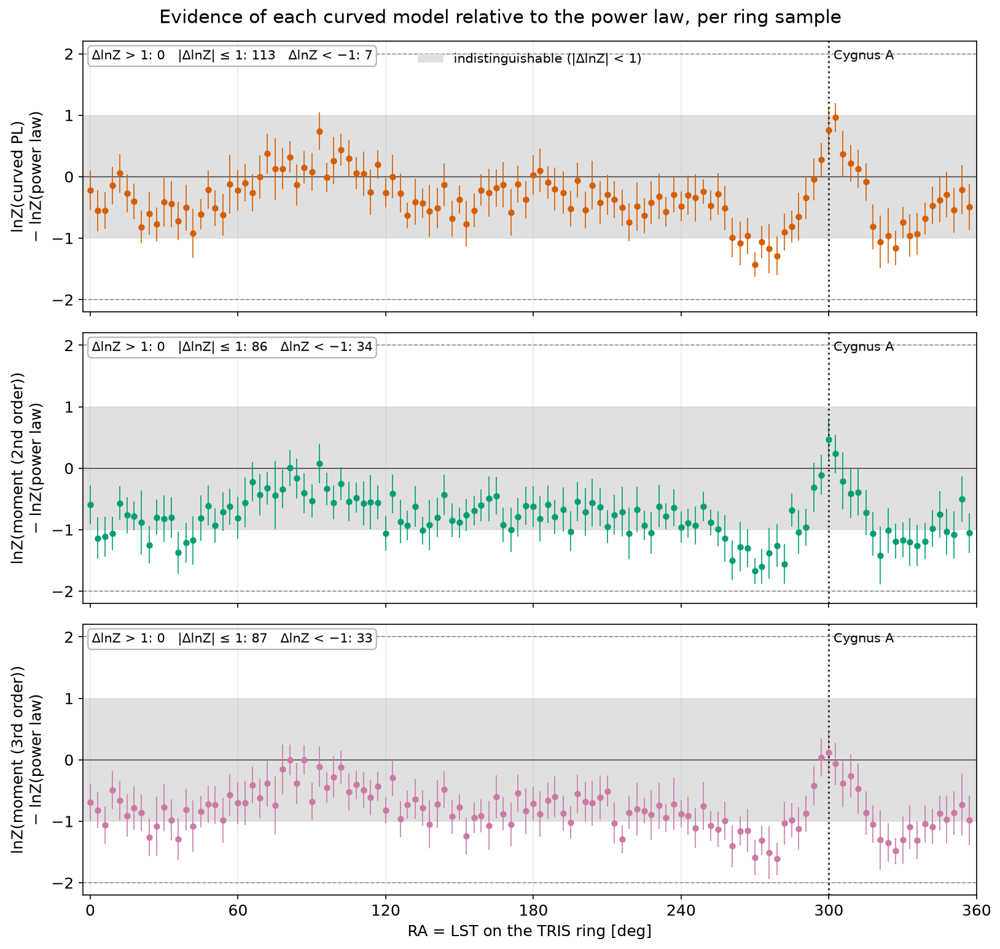
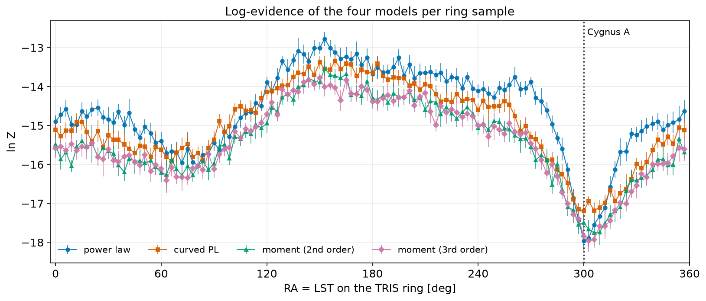
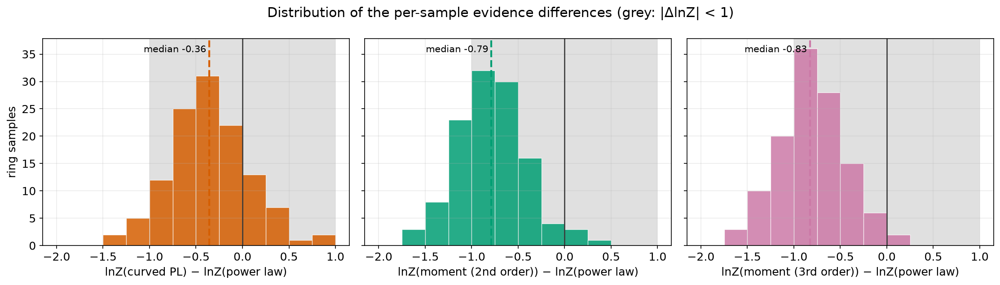
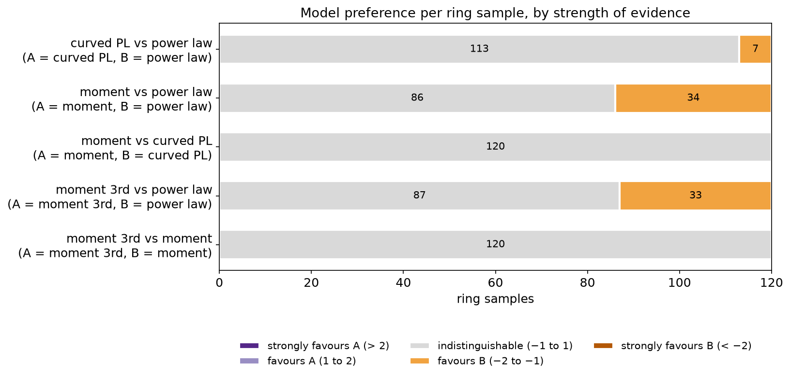
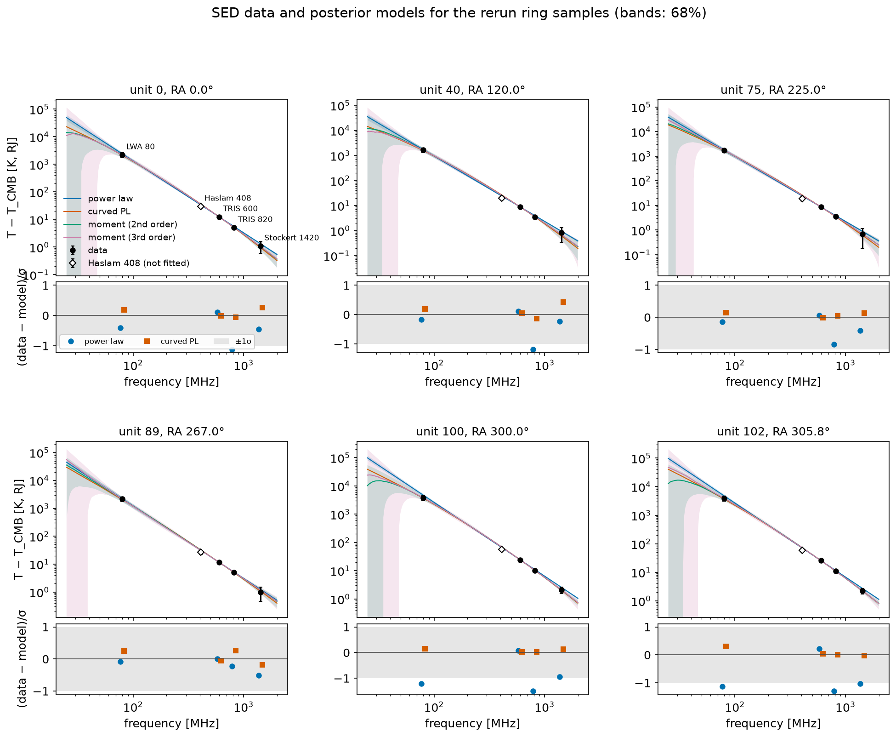
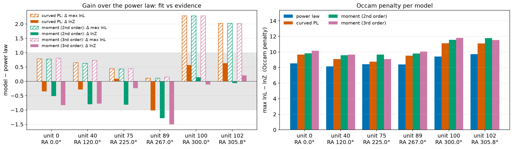
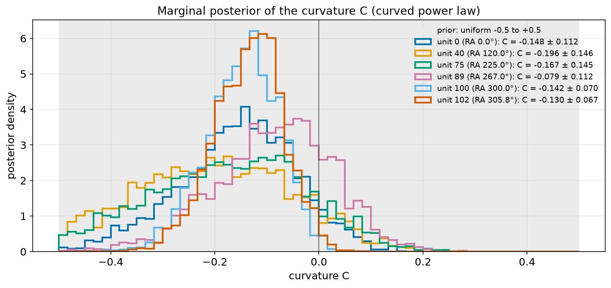
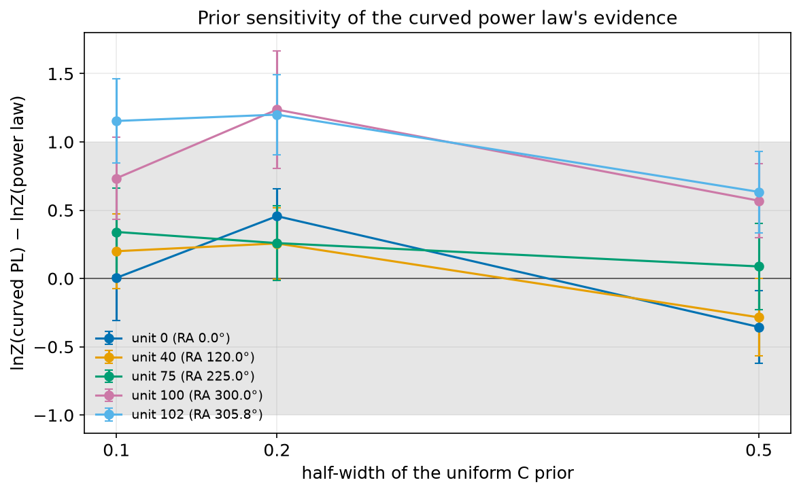
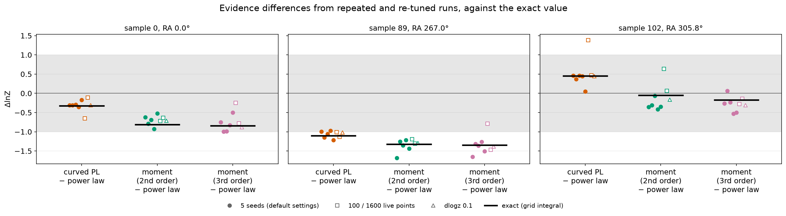

# Model comparison, run of 2026-10-27: beam-matched TODs, 4 points per ring sample

Archived on 2026-10-28, before the next test. This folder is a frozen record of one complete run of
`model_comparison/run_comparison.py` and of its diagnostics (`notebooks/11_model_comparison_diagnostics.ipynb`).
Nothing in it is regenerated by any code: the live files in `model_comparison/results/` and
`model_comparison/diagnostic_plots/` will be overwritten by the next run, these will not.

**In one sentence:** with four SED points per ring sample (TRIS 600, TRIS 820, LWA1 80, Stockert 1420), no
model with an extra spectral parameter is favoured anywhere on the TRIS ring; the power law has the highest
evidence in 97 of 120 samples and the curved power law in the other 23, but every one of those 23 is a tie.

## Contents

| Path | What it is |
|---|---|
| `README.md` | this record: setup, figures, numbers, conclusions |
| `results/evidence_per_unit_tod.csv` | the run's output: ln Z ± error per ring sample and model (120 rows) |
| `results/evidence_summary_tod.csv` | the run's output: summed ln Z per model (see the caveat on sums below) |
| `run_inputs/config.yaml` | the model comparison's settings: route, models, priors, sampler |
| `run_inputs/error_bars.csv` | the error bar of each input |
| `run_inputs/run_config.yaml` | the pipeline config (`sed.exclude_maps`, `sed.tod_beam`, the TRIS beam) |
| `code_snapshot/` | `run_comparison.py`, `models.py`, `sed_prototype.py` as they were for this run |
| `diagnostics/figures/fig1`–`fig9` | every figure of notebook 11, from this run |
| `diagnostics/tables/convergence_check1`–`4*.csv` | notebook 11 Part 4 tables, as the notebook wrote them |
| `diagnostics/tables/part1_*.csv`, `part2_*.csv`, `part3_*.csv` | the numbers notebook 11 printed or plotted, saved as tables for this record (computed from the results CSV and notebook 11's cache, no refits) |
| `diagnostics/tables/haslam_408_ring_tod_plotted_not_fitted.csv` | the Haslam ring TOD drawn in Fig 5 |
| `diagnostics/11_model_comparison_diagnostics_executed.ipynb` | notebook 11 with all its outputs, as run on 2026-10-28 |

SHA-256 of the result files, to check a copy against: `evidence_per_unit_tod.csv`
`288cadd647e6a90abe9c1ef749095159ac1af019790b99dae55ab10582130b53`, `evidence_summary_tod.csv`
`bf6084bab4f6d03b184972092104152733bc0da206001509fe3e0a6cdb1c8b05`.

## 1. What was run

### When and with what code

- `run_comparison.py` finished on **2026-10-27 17:13**. Notebook 11 was run on **2026-10-28** (14:12–14:23)
  on the same results and the same TODs.
- Repository at commit `b351b5f` (branch `fwhm-scaling-test`) **plus uncommitted changes**. The files that
  define the run were last modified before the run (`sed_prototype.py` 15:33, `models.py`, `run_comparison.py`
  and `config.yaml` 16:21, `run_config.yaml` 16:28, `error_bars.csv` 2026-10-21), so the copies in
  `code_snapshot/` and `run_inputs/` are the versions that made these results.
- Environment `limtod`: UltraNest 4.6.3, NumPy 2.5.2.
- Command: `python model_comparison/run_comparison.py` (default `--config model_comparison/config.yaml`).

### Data

- **Route:** TOD (`data.route: tod`). One SED per TRIS ring sample: 120 samples, 3° apart in RA along
  Dec +42.4° (RA = LST of the zenith drift scan).
- **Points per sample: 4, the same four at every sample.**

  | Input | Frequency | Error bar | Typical σ / T |
  |---|---|---|---|
  | TRIS 600 (ring data) | 600.5 MHz (effective) | statistical ⊕ published zero level, 0.066 K | 0.3–0.5% |
  | TRIS 820 (ring data) | 817.8 MHz (effective) | statistical ⊕ published zero level (+0.43 K, larger side) | 4–9% |
  | LWA1 80 MHz | 80 MHz | 20% of T (Dowell et al. 2017) | 20% |
  | Stockert + Villa-Elisa | 1420 MHz | 5% ⊕ 0.5 K ⊕ 17 mK (Testori et al. 2001) | 23–46% (at the six rerun samples) |

  The σ/T column is from the six samples rerun in Part 2. Temperatures are CMB-removed Rayleigh–Jeans. TRIS 600 dominates every fit: its σ is about 100 times smaller,
  relative to T, than any other point's.
- **Left out** (`sed.exclude_maps` in `run_config.yaml`): ARCADE 2 (3.15, 3.41 GHz; since 2026-10-15),
  and since 2026-10-27 **LWA1 35 MHz, Maipu 45 MHz, Juno 600 and Juno 1248 MHz**. The reason for the 2026-10-27
  additions is not recorded in the repo (TODO N-21). CHIPASS and Rhodes do not reach the ring.
- **Ring TODs: beam-matched** (`sed.tod_beam: beam_matched`; `sed_prototype.Inputs.ring_tod`). Each map is
  smoothed with the measured TRIS cut beam (19.155° × 23.366°, E plane 7° east of the meridian) with the map's
  own beam taken out, and read at the 120 ring pointings (the same TODs as `notebooks/18`). A sample is used
  only where the map covers at least half the beam weight; LWA1 80 and Stockert cover all 120.
- **Haslam 408 MHz** (`HASLAM_DESTRIPED_ONLY.fits`) is the target map. It is **not** a fit point; Fig 5 only
  draws it for comparison.
- Every input carries its published error; no placeholder error bars (`placeholder_points` = 0).

### Models, likelihood, priors, sampler

With x = ln(ν / 408 MHz) and T the CMB-removed RJ temperature (`models.py`):

| Model | T(ν) | Free parameters |
|---|---|---|
| power law | A·e^(βx) | A, β |
| curved power law | A·e^(βx + Cx²) | A, β, C |
| moment expansion (order 2) | A·e^(β̄x)·(1 + ω₁x + ω₂x²/2), β̄ = −2.7 fixed | A, ω₁, ω₂ |
| moment expansion (order 3) | A·e^(β̄x)·(1 + ω₁x + ω₂x²/2 + ω₃x³/6), β̄ = −2.7 fixed | A, ω₁, ω₂, ω₃ |

- Priors, all independent (`config.yaml`, not tuned to the data): A log-uniform 1–1000 K; β uniform −3.5 to
  −1.5; C uniform −0.5 to +0.5; ω₁, ω₂, ω₃ uniform −1 to +1. C and ω₂/2 have the same range, so neither
  curvature term gets a wider prior.
- Gaussian likelihood in T with the diagonal errors above.
- UltraNest `ReactiveNestedSampler`, 400 live points, dlogz 0.5 (its defaults), one run per sample and model.
- With 4 points, the power law has 2 degrees of freedom, the curved power law and order 2 have 1, and
  **order 3 has none**.

### How to read ΔlnZ

ΔlnZ = lnZ(model) − lnZ(power law), per ring sample. |ΔlnZ| ≤ 1: the two cannot be told apart (tie);
1–2: favoured; > 2: strongly favoured. Each ln Z has a sampling error of about ±0.22, so a difference has
about ±0.31.

**No summed evidences are used for conclusions.** Neighbouring ring samples are 3° apart under a ~20° beam,
so they are strongly correlated, and a sum over the 120 samples overstates the evidence many times over. The
sums the script writes are listed once, in section 2, for the record only.

## 2. Headline numbers

Per-sample classes (`diagnostics/tables/part1_dlogZ_classes_and_stats.csv`):

| A − B | A > 2 | A 1–2 | tie | B 1–2 | B > 2 | median ΔlnZ | lowest (RA) | highest (RA) |
|---|---|---|---|---|---|---|---|---|
| curved PL − power law | 0 | 0 | 113 | 7 | 0 | −0.36 | −1.43 (270.0°) | +0.96 (302.8°) |
| moment 2nd − power law | 0 | 0 | 86 | 34 | 0 | −0.79 | −1.67 (270.0°) | +0.47 (300.0°) |
| moment 3rd − power law | 0 | 0 | 87 | 33 | 0 | −0.83 | −1.61 (279.0°) | +0.11 (300.0°) |
| moment 2nd − curved PL | 0 | 0 | 120 | 0 | 0 | −0.42 | −0.92 (182.8°) | +0.13 (285.0°) |
| moment 3rd − moment 2nd | 0 | 0 | 120 | 0 | 0 | −0.04 | −0.58 (216.0°) | +0.57 (9.0°) |

Highest ln Z per sample: power law 97, curved power law 23, moment order 2: 0, order 3: 0. Of the curved
model's 23, all are ties (largest +0.96).

For the record only (correlated samples, see above), `evidence_summary_tod.csv`: summed ln Z −1755.2
(power law), −1797.0 (curved, −41.7), −1848.5 (moment order 2, −93.2), −1851.4 (moment order 3, −96.2), each
±2.5–2.6.

## 3. Part 1: the per-sample evidence along the ring

### Figure 1: ΔlnZ along the ring

One panel per extended model, against the power law. Grey: tie band; dashed: ±2; dotted: Cygnus A (RA 299.9°).

- **Curved power law:** a tie at 113 samples. It is worse by more than 1 at 7 samples, all on either side of
  Cygnus: RA 264–279° (lowest −1.43 at 270°) and 321–327°. It is above zero at 23 samples, in three groups:
  RA 72–123°, 180–183°, and 297–312° around Cygnus, where it peaks at +0.96 (RA 302.8°), still a tie.
- **Moment expansion, order 2:** worse by more than 1 at 34 samples, spread around the ring and densest at
  RA 258–288° and 318–357°. Above zero only at 4 samples (RA 81°, 93°, 300°, 303°; highest +0.47).
- **Moment expansion, order 3:** almost the same pattern as order 2: worse by more than 1 at 33 samples,
  above zero only at RA 297° and 300° (highest +0.11).
- All three panels share one shape: the extended models do relatively best near Cygnus and worst just before
  it (RA 260–290°) and just after it (RA 315–340°).

### Figure 2: ln Z of the four models

The absolute level follows how tightly the points constrain each sample, so it is the gaps between the lines
that matter. The power law (blue) is on top for most of the ring. The curved power law (orange) is the only
one to rise above it, at RA 297–312° and in the RA 72–123° stretch, by less than 1. Orders 2 and 3
(green, pink) lie on top of each other.

### Figure 3: distribution of ΔlnZ

Medians −0.36 (curved), −0.79 (order 2), −0.83 (order 3). No sample of any model reaches ΔlnZ = +1.

### Figure 4: preference counts

The table in section 2, drawn as bars. Nothing purple ("favours A") appears in any row, and nothing is
strongly favoured either way.

## 4. Part 2: posteriors, best fits and maximum likelihood (six samples rerun)

`run_comparison.py` saves only ln Z, so notebook 11 reran all four models at six samples to get posteriors and
maximum likelihoods: RA 0° (unit 0), 120° (40), 225° (75), 267° (89, the power law's strongest region),
300° (100, Cygnus) and 305.8° (102, Cygnus). Same data, priors and sampler as the run. The reruns reproduce the
saved ln Z within the sampling error (largest difference 0.38, unit 75 power law; UltraNest was not seeded in
the original run). Tables: `part2_reruns_lnZ_maxlogL.csv`, `part2_posterior_parameters.csv`.

### Figure 5: data and fitted models

Black: the four fit points; open diamond: Haslam 408 (not fitted). Lines: posterior medians; bands: 68% (none
for the curved power law). Lower panels: (data − model)/σ for the power law and the curved power law.

- All four models go through the four points; residuals are within 1.5σ for the power law and 0.42σ for the
  curved power law. The power law's largest residuals are at Cygnus (units 100, 102), where
  LWA1 80 and TRIS 820 sit about 1.1–1.5σ below it.
- The models only differ below 80 MHz, where there are no data. The wide grey and pink bands there are the
  order-2 and order-3 posteriors spreading out where nothing constrains them.
- Power-law fits: β = −2.60 to −2.64 (±0.06 to ±0.09) at all six samples; A (the 408 MHz temperature) from
  24.1 K (RA 225°) to 69.4 K (RA 305.8°).
- **Haslam sits below the power-law prediction at 408 MHz at all six samples:** by 4.3 K (RA 0°), 4.4 K (120°),
  5.0 K (225°), 5.3 K (267°), 9.8 K (300°) and 10.3 K (305.8°). Haslam's own error bar there is 3.6–6.6 K
  (10% ⊕ 3 K), so each is a 1.0–1.6σ difference.

### Figure 6: better fit or Occam penalty?

| unit (RA) | Δ max lnL, curved / order 2 / order 3 | ΔlnZ, curved / order 2 / order 3 |
|---|---|---|
| 0 (0°) | +0.79 / +0.78 / +0.81 | −0.36 / −0.52 / −0.83 |
| 40 (120°) | +0.65 / +0.63 / +0.73 | −0.28 / −0.80 / −0.78 |
| 75 (225°) | +0.44 / +0.43 / +0.44 | +0.09 / −0.82 / −0.24 |
| 89 (267°) | +0.12 / +0.11 / +0.15 | −1.01 / −1.29 / −1.50 |
| 100 (300°) | +2.29 / +2.28 / +2.29 | +0.57 / +0.14 / −0.11 |
| 102 (305.8°) | +2.02 / +2.02 / +2.02 | +0.63 / −0.06 / +0.21 |

- The three extended models improve the best fit by the **same** amount at every sample (to within 0.1 in
  lnL): they all capture the same small curvature, and the third-order term adds nothing to the fit.
- Away from Cygnus the gain in fit is 0.1–0.8 in lnL, at Cygnus about 2. The extra parameter's Occam penalty
  (right panel) is 1.0–2.4 larger than the power law's (power law 8.1–9.7; curved 8.8–11.1; order 2 9.6–11.8;
  order 3 9.1–11.8), which cancels the gain: at Cygnus the evidence gain shrinks to +0.6 at most.

### Figure 7: posterior of the curvature C

| unit (RA) | C (median ± std) | C / σ | P(C < 0) |
|---|---|---|---|
| 0 (0°) | −0.148 ± 0.112 | −1.3 | 0.93 |
| 40 (120°) | −0.196 ± 0.146 | −1.3 | 0.90 |
| 75 (225°) | −0.167 ± 0.145 | −1.2 | 0.88 |
| 89 (267°) | −0.079 ± 0.112 | −0.7 | 0.77 |
| 100 (300°) | −0.142 ± 0.070 | −2.0 | 0.99 |
| 102 (305.8°) | −0.130 ± 0.067 | −2.0 | 0.99 |

C is negative at all six samples (the spectrum steepens towards high frequency), at 0.7–2.0σ, and is best
constrained at Cygnus, where T is largest. The posteriors fill well under half of the ±0.5 prior.

The moment expansions agree: ω₂ is negative at every sample (−0.06 to −0.22, best constrained at Cygnus,
−0.22 ± 0.10 and −0.20 ± 0.10). **ω₃ is not constrained at all:** its posterior std is 0.53–0.59 at every
sample, the same as a flat ±1 prior (0.58), so order 3's posterior for ω₃ is its prior.

## 5. Part 3: does the curved model's evidence depend on the width of the C prior?

### Figure 8: ΔlnZ against the C prior width

The curved power law rerun with C uniform in ±0.5 (the config), ±0.2 and ±0.1, at five samples
(`part3_prior_sensitivity_C.csv`):

| unit (RA) | C ±0.5 | C ±0.2 | C ±0.1 |
|---|---|---|---|
| 0 (0°) | −0.36 | +0.46 | +0.00 |
| 40 (120°) | −0.28 | +0.26 | +0.20 |
| 75 (225°) | +0.09 | +0.26 | +0.34 |
| 100 (300°) | +0.57 | +1.24 | +0.73 |
| 102 (305.8°) | +0.63 | +1.20 | +1.15 |

(errors on each value 0.25–0.45.)

- Narrowing the prior from ±0.5 to ±0.2 raises ΔlnZ by 0.2–0.8 everywhere: the posteriors (|C| ≲ 0.2) fit inside
  ±0.2, so the narrower prior wastes less volume.
- At Cygnus that is enough to cross +1 (units 100 and 102: +1.24 and +1.20 at ±0.2; 102 still +1.15 at ±0.1),
  i.e. **"favours curved" at Cygnus depends on the prior width**. At ±0.1, unit 100 drops back to +0.73
  because its C (−0.14 ± 0.07) is pushed against the prior edge.
- Away from Cygnus the sign of ΔlnZ flips with the prior (units 0, 40), but every value stays inside the tie
  band, so the verdict (tie) does not change.

## 6. Part 4: is the evidence converged?

Three samples (RA 0°, a tie; 267°, the power law's strongest; 305.8°, Cygnus), all four models; 96 seeded
UltraNest runs and 12 exact grid integrals (the grid uses 41 and 81 points per axis for 2–3 parameters, 25 and
41 for order 3). Tables `convergence_check1`–`4*.csv`.

### Figure 9: ΔlnZ from every run against the exact value

- **Check 1, the exact integral:** doubling the grid changes ln Z by at most 0.004, so the grid values are exact
  for this purpose. UltraNest at the default settings lands within 0.31 of them (worst: RA 267°, order 2, −0.31
  against a quoted 0.21), within its quoted error in 9 of 12 cases.
- **Check 2, five seeds:** the scatter (std) is 0.09–0.22, against quoted errors of 0.19–0.29: the quoted error
  is honest, slightly generous. The mean of five runs is within 0.15 of the exact value in every case.
- **Check 3, settings:** 1600 live points and the stricter stop (dlogz 0.1) both land within 0.13 of the exact
  value everywhere. **100 live points are too few:** up to 0.76 off (RA 305.8°, curved: −16.48 against −17.24).
  1600 live points cost about 3.4× the likelihood calls of the default (40 233 against 11 706).
- **Check 4, verdicts:** 68 of 72 runs give the same verdict as the exact integral. The 4 that differ are all at
  a value close to a boundary: RA 267° curved (exact −1.10; 2 runs just above −1), RA 267° order 3 (the 100-live-
  point run, −0.79 against exact −1.34) and RA 305.8° curved (the 100-live-point run, +1.38 against exact +0.45).

Sampling noise (≈ 0.1–0.2 in ln Z) is small next to the effects discussed here. A ΔlnZ within about 0.3 of ±1
should be read as borderline.

## 7. Change from the previous run

The previous run (2026-10-21/22, still in git at `b351b5f` as `model_comparison/results/evidence_*_tod.csv`) had
**6 points per sample** (adding LWA1 35 and Maipu 45), the **earlier limTOD ring TODs**, and three models (no
order 3):

| | previous run (6 points, old TODs) | this run (4 points, beam-matched) |
|---|---|---|
| curved − PL: favoured / tie / disfavoured | 12 / 98 / 10 | 0 / 113 / 7 |
| curved − PL: strongly favoured (> 2) | 6 | 0 |
| curved − PL: highest | +4.35 at RA 305.8° | +0.96 at RA 302.8° |
| moment order 2 − PL: favoured / tie / disfavoured | 7 / 48 / 65 | 0 / 86 / 34 |
| moment order 2 − PL: highest | +3.34 at RA 302.8° | +0.47 at RA 300.0° |
| highest ln Z (PL / curved / order 2) | 77 / 43 / 0 | 97 / 23 / 0 |

The clear curvature preference at Cygnus is gone. The two runs differ in two ways at once, the input set and
the TODs, and these results alone cannot separate them. The TOD change was small (`notebooks/18`: median
−30 K of ~14 000 K at LWA1 35, −1.9 K at LWA1 80, at most 264 K at Cygnus for LWA1 35), and removing the only
two points below 80 MHz shortens the frequency lever arm a lot, so the input set is the more likely cause; a run
with 6 points and beam-matched TODs would test it.

## 8. Conclusions

What this run supports, on these four points and these error bars:

1. **A single power law is enough along the whole TRIS ring.** No extended model is favoured (ΔlnZ > 1) at any
   of the 120 samples; the power law has the highest evidence at 97.
2. **The curved power law is indistinguishable from the power law** (113 ties). It is disfavoured only at 7
   samples next to Cygnus (RA 264–279°, 321–327°) and at best ties (+0.96) at Cygnus.
3. **The moment expansions are disfavoured more often** (33–34 samples worse by > 1) and never beat the curved
   power law (120 ties, median −0.42). They fit as well as the curved power law (same max lnL) but carry a larger
   Occam penalty (by up to ~1 at the rerun samples).
4. **Order 3 adds nothing:** it ties with order 2 at all 120 samples (median −0.04), improves the best fit by
   ≤ 0.1 in lnL, and ω₃ is unconstrained (posterior = prior). With 4 points it has no degrees of freedom, so
   its evidence mostly measures its prior volume. It cannot be tested on this input set.
5. **There is a hint of steepening, not a detection:** C is negative at all six rerun samples (−0.08 to −0.20,
   0.7–2.0σ), strongest at Cygnus, but at the ±0.5 prior the better fit does not pay for the extra parameter.
   With a ±0.2 prior Cygnus reaches ΔlnZ ≈ +1.2, so whether Cygnus "favours curvature" depends on the prior.
6. **The spectral index is close to −2.6** at all six rerun samples (−2.60 to −2.64, ±0.06–0.09).
7. **Haslam is colder than the power-law prediction at 408 MHz** at all six rerun samples, by 4.3–10.3 K
   (1.0–1.6σ of Haslam's own error), most at Cygnus. The prediction is an interpolation between LWA1 80 and
   TRIS 600.
8. **The sampler is not the limiting factor:** ln Z is reproducible to ≈ 0.1–0.2, matches the exact integral to
   ≤ 0.31 at the default settings, and the verdicts only change for values within ~0.3 of ±1.
9. **Compared with the previous 6-point run, the Cygnus curvature preference has disappeared;** most likely
   because LWA1 35 and Maipu 45 were removed, but not yet separated from the TOD change.

## 9. Caveats

- **Few points and one dominant point.** The fits rest on TRIS 600 (σ 0.3–0.5%); LWA1 80 (20%) and Stockert
  (23–46%) are weak, so curvature is only weakly constrained and the models differ mostly where there are no data
  (below 80 MHz).
- **Correlated samples.** The 120 samples are not 120 independent tests; counts are a description along the ring,
  not votes, and sums overstate.
- **Diagonal errors.** Survey scale and zero-level errors are common to all of a survey's points but are treated
  as independent per sample (TODO N-15).
- **The excluded maps.** Why LWA1 35, Maipu 45 and Juno were dropped is not recorded (TODO N-21). The conclusions
  hold for this input set only.
- **Priors.** The curved model's evidence depends on the C prior width (section 5); the moment expansion's depends
  on the fixed β̄ = −2.7.
- **Part 2–4 cover a few samples only** (six, five and three).

## 10. How to reproduce

1. Restore `run_inputs/config.yaml`, `run_inputs/error_bars.csv` and the `sed:` block of `run_inputs/run_config.yaml`
   into `model_comparison/` and `configs/`, with the code in `code_snapshot/`.
2. `python model_comparison/run_comparison.py` (environment `limtod`). The original run was not seeded, so ln Z will
   agree within the sampling error (≈ 0.2), not exactly.
3. Run notebook 11 with the settings stored in the executed copy (`RERUN_UNITS = [0, 40, 75, 89, 100, 102]`,
   `SENS_UNITS = [0, 40, 75, 100, 102]`, `CONV_UNITS = [0, 89, 102]`, `CONV_SEEDS = [1, 2, 3, 4, 5]`,
   `CONV_LIVE = [100, 1600]`). Part 4 is seeded and reproduces exactly; Parts 2–3 are not seeded.
